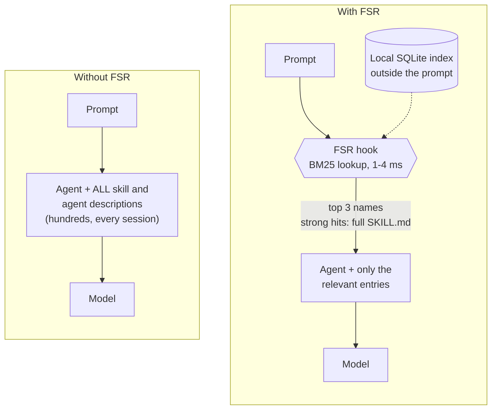
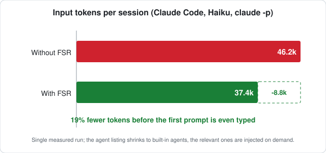

# FastSkillRetrieval

**Local, versioned capability retrieval for coding agents.**
Index skills, subagents and workflows once, then find the few that matter for a request
in milliseconds. No LLM calls, no network, no API keys.


Technical documentation lives in the [wiki](https://github.com/manuel-albanesee/FastSkillRetrieval/wiki).

## Why

Agent setups accumulate hundreds of skills. Loading all their descriptions into every
session wastes context; guessing which one applies wastes turns. FastSkillRetrieval keeps
the catalog outside the prompt and returns a bounded shortlist on demand.

- **Deterministic.** SQLite FTS5 with BM25 and fixed field weights. The same query on the
  same catalog returns the same result.
- **Versioned and verifiable.** Every published capability is an immutable, hashed
  snapshot. A tampered package returns `stale_reference` instead of loading.
- **Budgeted.** Cards, load groups and per-session output have hard byte limits, so
  retrieval cannot flood the context.
- **Read-only on your sources.** Original skill folders are never modified, and the
  framework never executes scripts or models.
- **Two front ends.** A CLI and a `stdio` MCP server expose the same operations.

## How it works

Without FSR every session pays for the whole catalog; with FSR the catalog stays outside
the prompt and only the few matching entries are injected per request.





### What is measured, what is estimated

| Claim | Status | Value |
|---|---|---|
| Input tokens per session saved by hiding the callable agents | **Measured** (`claude -p`, Haiku, single run) | 46.2k to 37.4k, so 8.8k fewer (about 19%) |
| Hook lookup time | **Measured** (registry opened read-only) | about 1 to 4 ms |
| Skills hidden from the resident list | **Not measured** | no token figure is claimed |
| Net saving per request (after the names and `SKILL.md` the hook injects) | **Not measured** | no figure is claimed |
| Size of a full catalog, if everything were loaded | **Estimate** (bytes / 4, not a tokenizer count) | see below |

The measured saving comes from the agent listing only. At session start Claude Code hands the
model the list of every callable agent, and in the measured setup that list accounted for
about **8.8k input tokens (roughly 19% of the session)**. FSR shrinks it to the built-in
agents and injects the right descriptions on demand (see
[What the hook injects](#what-the-hook-injects)). The 8.8k is the net difference between the
two runs, so it already includes what the hook injected in the FSR run. It is one run, not a
guaranteed ratio, and the gross size of the list was not measured separately.

### What you gain beyond the token count

Claude Code keeps the skill list resident in every session, and that list is bounded by a
character budget. The
[official skills page](https://code.claude.com/docs/en/skills) says the combined
`description` and `when_to_use` text is truncated at 1,536 characters per skill and that every
skill in the listing adds to context on every turn. Past the budget, whole descriptions are
dropped. An independent test
([dev.to, Claude Code 2.1.289, 2026-10-05](https://dev.to/rulestack/with-160-skills-installed-claude-code-kept-20-descriptions-and-the-model-found-0-of-3-skills-that-10j2))
installed 160 skills with 1,000-character descriptions and found only 20 kept their
description under a 30,000-character budget. Skills left with the name only were invoked in
0 of 3 runs, while skills that kept their description were invoked 7 of 7 times. The exact
count depends on description length, context window and settings, so the number of skills
that fit is not a fixed 50. These are third-party figures, not measurements made in this
repo. FSR removes that ceiling, because the catalog lives in a local index instead of the
prompt.

Estimated size of one real catalog (483 skills and 86 agents, bytes / 4):

| | Descriptions only | Full definitions |
|---|---|---|
| Skills | about 32k tokens | about 1.07M tokens |
| Agents | about 4k tokens | about 132k tokens |

Loading it all is impossible, since the full definitions are far beyond any context window,
and even the descriptions alone would take 32k tokens per session. With FSR the whole
catalog stays reachable: each request pays for at most three named matches, and only strong
hits bring in the full `SKILL.md`.

- **Scale without a ceiling.** Hundreds of skills and agents stay searchable instead of
  being capped by what fits in the prompt.
- **Fast.** The lookup takes about 1 to 4 ms and needs no model call and no network, so it
  adds no perceptible delay to a prompt.
- **Deterministic and local.** The same request returns the same shortlist, offline.

```
 source root            registry (state dir)                 client
 skills/<name>/  -->  discover -> submit -> publish  -->  search / load / resource
 SKILL.md             validated metadata, snapshots,       CLI  or  MCP over stdio
                      FTS5 index, session budgets
```

1. `discover` scans an authorized source root (one skill per subfolder, each with `SKILL.md`).
2. `submit` attaches reviewed metadata: description, aliases, capabilities, use-when
   conditions, exclusions, technologies.
3. `publish` builds complete snapshots, then activates the catalog in one SQLite transaction.
4. `search` returns at most five capability cards ranked by BM25; `load` and `resource`
   emit the full instructions only for what was selected.

## Quick start

Requires Python 3.13 and [uv](https://docs.astral.sh/uv/). The agent hook also needs Node.js 22.5 or newer.

```bash
uv sync --frozen --extra dev
uv run python -m fastskillretrieval --help
```

Try it on the bundled example skills:

```bash
uv run python -m fastskillretrieval --source-root examples/skills --state .fsr \
  --session demo inventory --refresh
```

The step-by-step walkthrough (inspect, submit, publish, search, load) is in the
[full guide](doc/Guida_IT.md), currently written in Italian.

## Use it with your coding agent (Claude Code, Codex)

FastSkillRetrieval can index every skill, subagent and slash command you have installed and
suggest the relevant ones **before** your request reaches the model, through a read-only
`UserPromptSubmit` hook. The hook needs Node.js 22.5 or newer (it reads the index with `node:sqlite`).

```bash
fastskillretrieval install --agent claude      # or: --agent codex
```

`install` registers the hook, adds the `/fsr-init-index` command and then builds the index
(`init-index --if-stale`), so the first prompt after installing is already covered.

| Command | What it does |
|---|---|
| `install [--agent] [--no-index] [--no-agent-listing]` | Merges the hook into `~/.claude/settings.json` (Codex: `~/.codex/hooks.json`). Idempotent, keeps a one-time `.fsr-backup`, never touches entries it did not create. An indexing failure is reported without failing the install. |
| `uninstall [--agent]` | Removes only what `install` added. |
| `init-index [--agent] [--project DIR] [--if-stale]` | Discovers user, project and plugin skills, agents and commands (disabled plugins are skipped), stages copies under `~/.fsr/sources/<agent>/` and publishes the registry to `~/.fsr/index/<agent>/`. `--if-stale` skips the rebuild when the installed set is unchanged. A full rebuild of about 570 items takes roughly three minutes, with a console progress display. |
| `hide-skills [--restore]` | Marks plugin skills `disable-model-invocation: true`, so the resident skill list shrinks and FSR is the way they reach the model. Original bytes are saved and `--restore` is exact. Run it again after a plugin update. |
| `hide-agents --plugin NAME [--keep plugin:agent] [--dry-run] [--restore]` | Writes `Agent(plugin:agent)` deny rules into the settings file, with a byte-exact backup. |

After installing, the first session (Codex: the first prompt) shows a one-time notice in the
agent's chat, for you only and at no token cost: FSR is installed and you should run
`/fsr-init-index` to enable the automatic, per-request injection of agents and skills.

Codex requires you to trust the new hook once from its `/hooks` screen.

### What the hook injects

- It opens the registry read-only (about 1 to 4 ms) and **names** the best matches (at most
  three). Bare numeric tokens in the query are ignored, because they matched version strings
  in unrelated skills.
- Ranking favors the definition's own name: indexed descriptions are prefixed with the name
  words, so `typescript-reviewer` outranks a skill that merely mentions TypeScript.
- A hit is **strong** only when it matches enough of the request terms (`FSR_STRONG_COVERAGE`,
  default 0.3, counted against at most `FSR_STRONG_CAP` = 12 terms). Only strong skill and
  command hits get their full `SKILL.md` injected; weaker hits are just named, so a false
  positive costs a few tokens rather than a whole manual.
- Agent descriptions are injected once per session, because the `fsr-agent-listing` mod
  (installed by default, `--no-agent-listing` to skip) shrinks Claude Code's agent listing to
  the built-in agents. Measured with `claude -p` on Haiku, input per session dropped from 46.2k
  to 37.4k tokens. Agents left out of the listing stay dispatchable by name.
- Output is deterministic, and the hook never blocks a prompt: any problem yields no output.

### Environment variables

| Variable | Default | Meaning |
|---|---|---|
| `FSR_HOME` | `~/.fsr` | Moves the whole state folder. |
| `FSR_MODE` | `inject` | `inject`, `suggest` (log only to `~/.fsr/suggestions.jsonl`) or `off`. |
| `FSR_INJECT_BODY` | `on` | `off` stops injecting `SKILL.md` text. |
| `FSR_BODY_HITS` / `FSR_BODY_LIMIT` | 2 / 8000 | Max bodies injected, and bytes per body. |
| `FSR_INJECT_LIMIT` | 12000 | Total bytes of injected context (minimum 1000). |
| `FSR_STRONG_COVERAGE` / `FSR_STRONG_CAP` | 0.3 / 12 | Strong-match threshold. |
| `FSR_AGENT_DESC` | on | `off` stops injecting agent descriptions. |
| `FSR_UI` | `on` | `off` hides the session banner and per-prompt notices. |

`scripts/hook_eval.cjs` replays labelled prompts (`scripts/hook_eval_cases.json`) against your
index to tune the strong-match thresholds.

### Agent retrieval quality

Agents compete with hundreds of skills and commands, and their descriptions are often short or
written in one language only. Two measures keep them findable:

- **Italian-to-English query expansion.** The hook adds the English equivalents of Italian
  request terms (`semplifica` adds `simplify`) to the search only, so descriptions written in
  English are found from Italian requests. The expansion never counts toward strong-match coverage.
- **Reserved agent slots.** The hook runs a second query limited to agents and adds up to two
  that the global top three left out, with the same absolute threshold.
- **Description check before indexing** (`agent_quality.py`, deterministic, no model). It strips
  corrupt characters and adds the other language's glossary terms and light English stems to the
  agent's *aliases*, never to its description, so skill ranking is unaffected. The check version is
  part of the index signature, so `init-index --if-stale` rebuilds after a rule change.

`scripts/agent_eval.cjs [cases.json] [--verbose]` measures recall@3, top-1 and false positives
(`scripts/agent_eval_cases.json` lists agents installed on the maintainer's machine; adapt it to yours).

Used by [Caronte](https://github.com/manuel-albanesee/Caronte), which installs it automatically.

## MCP server

```bash
uv run python -m fastskillretrieval serve
```

A configuration template is in [`examples/mcp-config.template.json`](examples/mcp-config.template.json).
The source root is fixed at startup and is never accepted from a tool call.

## Search behavior

- BM25 field weights: description 5, capabilities 4, use-when 4, aliases 3, technologies 2.
- Queries are turned into quoted literal terms, never interpreted as FTS syntax.
  `C`, `C++` and `C#` stay distinct.
- Exclusions are not indexed as positive signals. Negations in natural language are not
  understood: use explicit filters (`--technology`, `--exclude-id`, `--explicit-id`).
- Popularity and validation scores never influence ranking.
- Descriptions are matched literally, so queries should use the language of the indexed
  descriptions. Translate or enrich queries upstream when your catalog is in another language.

## Querying the index from other runtimes

The registry is a plain SQLite file. A read-only consumer can open `registry.sqlite3`
directly and run an FTS5 query, which avoids starting Python for every lookup. For example,
`node:sqlite` answers a query in about 1 to 4 ms on a catalog of roughly 480 entries.

## Windows notes

Snapshots are stored under `packages/<24 hex>/<64 hex>/<file>`. With the default 260-character
`MAX_PATH` a long state directory can break publication, so the registry now fails early
with `policy_denied` / `state_path_too_long`. Use a short state path such as `C:/fsr`.

## Development

```bash
uv sync --frozen --extra dev
uv run python -m pytest -q
uv run ruff check src tests
```

Current status: 384 passed, 1 skipped (the skipped test is platform-specific).

## Project layout

| Path | Contents |
|---|---|
| `src/fastskillretrieval/` | registry, catalog, ingestion, planner, CLI, MCP server, agent install and hide tools |
| `src/fastskillretrieval/assets/` | prompt hook (`fsr-hook.cjs`) and the `fsr-agent-listing` mod |
| `tests/` | acceptance and regression tests |
| `schemas/` | JSON schemas for contracts |
| `examples/` | sample skills, candidate metadata, MCP config template |
| `scripts/` | benchmarks and verification scripts |
| `doc/` | design notes, evaluations and the [Italian guide](doc/Guida_IT.md) |
| `plans/` | implementation plans |

## Scope and limits

This is version 0.3. Byte counts used for budgets are a conservative estimate, not a
tokenizer count. The host verification matrix does not certify generalized preloading or
permission enforcement, and automatic planner dispatch is deliberately absent. See
[`doc/Capability_Host_Verification.md`](doc/Capability_Host_Verification.md).

## License

[MIT](LICENSE).
