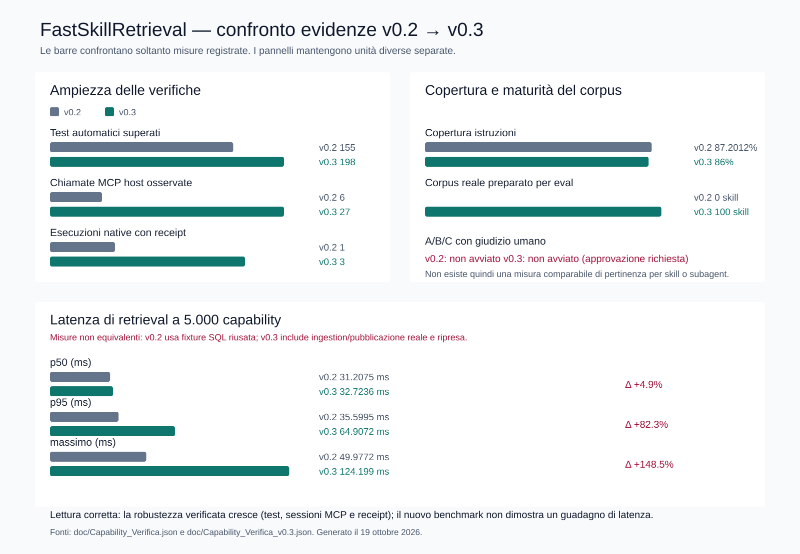

# Confronto v0.2 e v0.3

Il grafico separa le evidenze di robustezza dalla latenza. La v0.3 aumenta i test superati da
155 a 198, le chiamate MCP host osservate da 6 a 27 e le esecuzioni native con receipt da 1 a
3. Prepara inoltre un corpus reale di 100 skill per la valutazione.

Non esiste ancora un risultato A/B/C con giudizio umano, quindi non è possibile quantificare il
miglioramento della pertinenza del retrieval per singola skill o subagent. La copertura passa da
87,2% a 86% mentre il codice e i contratti coperti aumentano: va letto come misura tecnica, non
come regressione funzionale.

La latenza a 5.000 capability non dimostra un miglioramento: la v0.2 misurava una fixture SQL
riusata, la v0.3 una pipeline con ingestion e pubblicazione reali, completata tramite ripresa
controllata. Le due misure sono riportate per trasparenza ma non sono un confronto prestazionale
alla pari.



Rigenera il grafico con:

```powershell
$python = (Resolve-Path .venv/Scripts/python.exe).Path
& $python scripts/generate_comparison_chart.py
```
