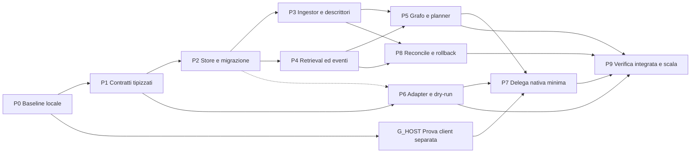

# FastSkillRetrieval — Analisi ECC e piano Capability Retrieval

Aggiornamento del 22 ottobre 2026: il lavoro residuo è ricostruito nel
[piano di completamento ECC](FastSkillRetrieval_Completamento_ECC.md).
Gli incrementi P0–P9 e i criteri CR01–CR16 qui sotto restano riferimenti storici stabili.

Data: 18 ottobre 2026. Stato: **implementazione locale v0.2 consegnata; gate nativo e utilità
ancora aperti**. Il testo seguente conserva l'analisi iniziale; l'avanzamento effettivo è in §9.

Fonte principale: [brainstorming Capability Retrieval](../doc/FastSkillRetrieval_Brainstorming_Capability_Retrieval.md).
Vincoli acquisiti: [proposta e decisioni §10](../doc/FastSkillRetrieval_Proposta_Soluzioni.md).
Baseline storica: [prima implementazione](../doc/Prima_Implementazione.md).

Metodo: ECC Product Capability per requisiti e invarianti; Blueprint per incrementi, dipendenze,
verifiche e recupero; Eval Harness per prove di capacità e regressione; Change Impact per
individuare chiamanti, dati e contratti interessati. La revisione indipendente del piano è
registrata in fondo. L'analisi riguarda codice e documenti locali; non certifica i runtime.

## 1. Capacità da realizzare

Uno sviluppatore con catalogo personale misto deve poter trovare una capacità pertinente,
conoscerne origine, revisione, prerequisiti e disponibilità nel client e ottenere un piano
minimo di utilizzo. Skill, subagent e workflow condividono il registro di discovery;
conservano contratti operativi differenti. Il registro propone; il runtime autorizza e attiva.

**Prima consegna utile:** skill, subagent e workflow ricercabili, alias risolti, dipendenze
verificate e piani `dry_run` spiegabili. Lettura delle sole skill semplici già supportate;
una singola prova di delega nativa segue un controllo separato del binding. Nessun processo
Python sostituisce gli strumenti del client per simulare deleghe, hook o permessi.

### 1.1 Regole confermate e conflitti da non riaprire implicitamente

| Tema | Lettura del nuovo brainstorming | Regola del piano |
|---|---|---|
| Stato del documento | Si dichiara knowledge base, non specifica approvata | L'ampliamento è una proposta da realizzare per incrementi; gli esempi non diventano requisiti nativi |
| Manutenzione, §§0/10/17 | Ripropone timer, watcher e trigger come decisioni emerse | Prevale la scelta esplicita del §10.1 precedente: **solo su comando**; scheduler e watcher esclusi |
| Generazione | Agente normalizzatore prima dell'ingest | Sessione attiva tramite tool; nessun provider LLM autonomo o credenziale API del client riutilizzata |
| Metadati | Proiezione curata e originale conservato | Originali immutati, candidate separate, massimo due tentativi per sorgente/regole/configurazione pertinente |
| Telemetria | Eventi per query, finestre 7/30/90 giorni, esposizione | Niente testo delle richieste o file nei log; eventi minimizzati entro 30 giorni e 100 MB totali |
| Storico a 90 giorni | Richiederebbe dati oltre retention degli eventi | Solo aggregati giornalieri senza contenuti; non conservare eventi dettagliati per aggirare la retention |
| Permessi | `requires_approval` in manifest | Campo informativo derivato da policy locale/runtime; non è né autorizzazione né obbligo di nuovo consenso a ogni chiamata |
| Client | Codex e Claude Code entrambi descritti | Prima Claude Code CLI diretto, Codex in estensione; matrice distinta per client/versione/superficie |
| Budget | Main agent e subagent separati | Conservare 5 candidati, 1.200/4.000/12.000 token stimati; costo deleghe separato, senza promettere controllo della spesa del client |
| Criteri di successo | §16 propone inizialmente sola consistenza | Conservare l'esperimento già confermato: 100 skill, 20 richieste concordate, nessuna perdita essenziale, riduzione obiettivo 30%, p95 300 ms |
| Basso utilizzo | Suggerisce revisione, non cancellazione | Findings descrittivi; archiviazione solo su scelta esplicita, reversibile |

Le scelte già confermate non richiedono nuove risposte. La prova 100/20 riguarda il confronto
storico sulle skill: l'estensione a subagent/workflow avrà fixture proprie e non cambia
retroattivamente il denominatore né le soglie dell'esperimento originale.

### 1.2 Fuori dal primo rilascio

Servizio remoto o multiutente, writer distribuiti, dashboard, ricerca vettoriale, giudizio
semantico LLM, scheduler, installazioni automatiche e controllo universale dei cataloghi
nativi. Il piano non introduce un proprio motore di permessi alternativo a quello dell'host.
Rules, hook, memoria e strumenti esterni vengono estesi soltanto nelle linee separate del §7.

## 2. Analisi critica e distanza dal codice

L'idea migliore del documento è separare **identità, revisione e disponibilità operativa**.
La parte da correggere nell'ordine di lavoro è la generalizzazione prematura: un campo
`kind` nel database non preserva la semantica di un agente, di una rule o di un hook.

| Priorità | Evidenza nel repository | Conseguenza per l'implementazione |
|---|---|---|
| Alta: integrazione ancora da dimostrare | `server.py:create_server` offre otto tool di assistenza; `Prima_Implementazione.md` non registra una prova conclusa nel client Claude | P0 verifica il client effettivo; discovery e `dry_run` restano utilizzabili anche se delega/gestione catalogo non sono supportate |
| Alta: versioni con significati diversi | `catalog.py:SCHEMA`: `versions` ha manifesto, candidata corrente e tentativi; `entries.metadata` conserva i metadati delle pubblicazioni | Separare revisione del pacchetto, del descrittore e del binding, mantenendo lo storico già esistente negli entry |
| Alta: migrazione inesistente | `Catalog.__init__` crea tabelle con `CREATE IF NOT EXISTS`; nessun `user_version` o migratore | Prima dello schema esteso servono backup coerente, identificazione esplicita del legacy e compatibilità dei riferimenti |
| Alta: conteggi non per capability | `Catalog.call` incrementa `counters` con chiavi come `search:ok`; `_search` non riceve request ID | Implementare `retrieved` finale, idempotenza e ledger; i vecchi conteggi non possono ricostruire recuperi individuali |
| Alta: confini di fiducia | `validate_candidate` ammette soltanto sei campi; `supported_instructions` blocca frontmatter operativo | Non allargare la candidata per permettere all'agente di impostare trust, permessi, tipo, approvazioni o binding |
| Media: lavoro lungo nel writer | `Catalog.call` apre `BEGIN IMMEDIATE` anche per ricerca; scansioni e snapshot avvengono nel percorso transazionale | Preparare file fuori dalla transazione; attivare catalogo, eventi e budget con transazioni brevi e controlli di revisione |
| Media: lotti non riprendibili | `_inventory` vede solo sottodirectory immediate e annulla oltre 100 versioni modificate | Introdurre cursore di scansione, lotti espliciti e ripresa prima della prova a 5.000 |
| Media: stato di sessione locale | `sessions.pins` e `emissions` legano skill/versione e consumo | Estenderli a piani e target di contesto senza azzerare budget o cambiare versione dopo migrazione/compattazione presunta |
| Media: catalogo eterogeneo | FTS e CLI sono specifici per skill; nessun parser di agent/workflow | Ingestor tipizzati su sorgenti esplicitamente autorizzate, senza scansione indiscriminata delle configurazioni personali |

La baseline **riportata il 17 ottobre** è 39 test superati, uno saltato e copertura 91%.
Non è stata rieseguita per scrivere questo piano. Git è su `main`, senza commit e senza
remoti: non esiste ancora uno SHA di riferimento; niente PR, push o CI remota impliciti.

### 2.1 Verifiche documentali mirate

- Claude distingue invocabilità e caricamento delle skill; il registro non deve inferire
  supporto nativo dalla sola lettura del corpo. [Documentazione skill Claude](https://code.claude.com/docs/en/skills).
- I subagent Claude hanno configurazione, strumenti e contesto propri; il preload di skill
  è una funzione specifica del client. Non rende automaticamente eseguibile un file ECC in
  un altro runtime. [Subagent Claude](https://code.claude.com/docs/en/sub-agents).
- La lettura di `AGENTS.md` da parte di Claude dipende anche da versione e configurazione:
  il modello di gerarchia non va hardcoded come identico a Codex.
  [Memoria e istruzioni Claude](https://code.claude.com/docs/en/memory).
- SQLite richiede di abilitare le foreign key per connessione; WAL conserva un solo writer;
  la copia di un database aperto richiede un metodo coerente.
  [Foreign key](https://www.sqlite.org/foreignkeys.html),
  [WAL](https://www.sqlite.org/wal.html), [Backup API](https://www.sqlite.org/backup.html).

Queste fonti verificano i vincoli generali, non l'installazione effettiva. Non si usano i
numeri di skill/agent del README ECC come inventario reale o come obiettivo di collaudo.

## 3. Contratto architetturale proposto

### 3.1 Componenti e responsabilità

```text
CLI / MCP
   -> servizi applicativi (inventario, preparazione, ricerca, piano, emissione)
      -> ingestor tipizzati -> descrittori validati -> registry SQLite/FTS5
      -> filtri/alias -> chiusura dipendenze -> planner con budget
      -> adapter runtime: osservazione / proposta / azione nativa supportata
      -> ledger minimizzato + aggregati + findings manuali
```

Resta un unico pacchetto Python, SDK MCP stdio e SQLite locale. Refactoring graduale di
`Catalog`; nessun servizio HTTP, database a grafo o framework di orchestrazione necessario.

| Modulo proposto | Responsabilità | Codice da preservare/adattare |
|---|---|---|
| `registry.py` + `migrations/` | Entità, pubblicazioni, transazioni, compatibilità | `catalog.py:SCHEMA`, `_publish`, `_active` |
| `ingestion/` | Skill, agent Markdown/TOML e workflow dichiarativi come dati | `_inventory`, `_inspect`, `_submit`, `contracts.py` |
| `retrieval.py` | FTS, filtri strutturati, spiegazione, alias | `_search`, `terms`, pesi BM25 attuali |
| `planner.py` | Dipendenze, conflitti, versioni, target e preventivo | `_reference`, `_load`, `_resource`, `Limits` |
| `runtime/` | Prove di disponibilità e proposta di binding; nessun esecutore shell generico | `server.py`, `supported_instructions` |
| `telemetry.py` + `maintenance.py` | Idempotenza, proiezioni, retention, reconcile manuale | `counters`, sessioni, pubblicazione atomica |
| `cli.py` e `server.py` | Adapter sottili e compatibilità ingressi skill esistenti | Comandi e otto tool attuali |

I nomi sopra sono proposti. Non creare tutti i moduli prima di avere il relativo incremento.

### 3.2 Modello dati minimo

| Entità | Contenuto e invarianti |
|---|---|
| `sources` | Provider, namespace, scope locale, radice autorizzata, revisione upstream; niente credenziali |
| `capabilities` | ID stabile assegnato dal registry, tipo, nome logico, stato operatore; stesso nome/hash non implica stessa identità |
| `source_revisions` | Manifesto/hash del pacchetto o definizione; payload originale e snapshot verificato |
| `descriptor_revisions` | Descrizione originale e derivata, evidenze, regole/vocabolario/configurazione, validazione e tentativi |
| `runtime_bindings` | Collegamento a definizione nativa e versione runtime; fingerprint di configurazione, senza valori segreti |
| `binding_observations` | Stato osservato, istante e provenienza del segnale; `unknown` se non osservabile, mai approvazione presunta |
| `relations` | Estremi e revisioni/vincoli, tipo, provenienza; relazioni di policy impostate fuori dalle candidate |
| `catalogs` + `catalog_entries` + FTS | Snapshot coerente di tutte le revisioni, regole/ranking e ambiti; attivazione atomica |
| `sessions`, `plans`, `emissions` | Revisione task, periodo, pin, target del contesto, preventivo e materiale effettivamente emesso |
| `request_ledger`, `events`, `daily_counters` | Idempotenza e misure senza testo query/file; proiezioni atomiche e ricostruibili entro retention |
| `maintenance_runs`, `findings`, `legacy_refs` | Ripresa, esclusioni, rollback e mapping verificato dei riferimenti legacy |

Distinguere gli stati, senza un unico `is_active`:

- Identità: `enabled / disabled / archived / quarantined`, gestiti dall'operatore/policy.
- Descrittore: `discovered -> preparing -> needs_revision | validated -> published -> superseded`.
- Binding: `unknown / not_supported / supported_not_installed / installed_unavailable /
  available_unapproved / available_approved / disabled_by_policy`, con prove e scadenza.
- Piano: `proposed -> blocked | ready -> dispatched -> completed | failed | outcome_unknown`.

Una nuova descrizione non valida non revoca da sola uno snapshot precedente valido. Un
ritiro di fiducia può invece bloccare tutte le revisioni interessate: rollback e riavvio
non possono annullarlo. `archived` non cancella sorgenti o storico.

### 3.3 Tipi e azioni ammesse

| Tipo | Primo percorso | Attivazione successiva e limite |
|---|---|---|
| `skill` | Discovery + emissione verificata delle skill semplici | Invocazione nativa solo se preservata e collaudata; niente trasformazione di frontmatter operativo in testo equivalente |
| `subagent` | Descriptor + piano `delegate` in dry-run | Il client deve vedere la definizione nativa e offrire uno strumento di delega idoneo |
| `workflow` | Manifesto dichiarativo con step, input/output e dipendenze | Nessun YAML/Markdown interpretato come shell; prima orchestration plan, poi eventuale esecuzione host verificata |
| `command` | Rappresentazione o `alias_of` se verificato | Parametri e side effect preservati; non collassare due comandi soltanto per nome o similarità |
| `rule`, `context` | Inventario provenienza; note opzionali separate | Policy obbligatorie restano risolte/enforced dal runtime; non dipendono da top-K o budget opzionale |
| `tool`, `hook` | Manifesto e stato diagnostico | Il database non connette MCP, non installa hook e non concede grants |
| `memory` | Dati con scope, origine e scadenza | Non promuovere memoria a policy o istruzione vincolante |
| `adapter` | Metadata di binding e compatibilità | Nessun codice plugin importato/eseguito dall'ingest |

### 3.4 Interfacce e invarianti

Le interfacce seguenti sono **da implementare**, non comandi già disponibili:

| Interfaccia logica | Input essenziale | Output e vincoli |
|---|---|---|
| `discover_sources` | Sorgenti autorizzate, tipi, lotto/cursore | Inventario completo, escluse e ragioni; niente pubblicazione o esecuzione |
| `submit_descriptor` | ID, revisione sorgente, candidata, configurazione | Esiti deterministici; non riceve campi di autorità o abilitazione |
| `search_capabilities` | Request/session/task revision, query, tipi, scope/runtime, modalità discovery/preparazione e vincoli | Massimo cinque risultati principali finali, scelti dopo dipendenze e vincoli della modalità; motivi, revisioni e conteggi separati |
| `plan_capabilities` | Risultati, obiettivo attivo, budget, osservazioni runtime | Piano minimo con dipendenze, azioni/target, costi main e delega, blocchi e provenienza |
| `prepare_capability_use` | Piano/revisioni e fingerprint correnti | Rivalida ritiro, disponibilità, policy, risorse e budget immediatamente prima dell'uso |
| `record_runtime_observation` | Segnale verificabile dell'host e operation ID | Distingue proposto, emesso, avviato e terminato; dichiarazioni del modello restano self-report |
| `reconcile` / `rollback_catalog` | Comando operatore, lotto/catalogo | Diff, findings, attivazione atomica o esito negativo; nessuna inferenza autonoma |

Riferimento v2: `schema_version`, `capability_id`, `source_revision`, `descriptor_revision`,
`binding_revision?`, `catalog_id`, `scope_id`. I tool legacy mantengono il loro contratto
skill tramite facade e mapping; nessun vecchio riferimento viene reinterpretato per nome.

Una ricerca senza risultati non maschera `catalog_not_ready`, `catalog_unavailable`,
`dependency_unavailable`, `policy_denied`, `budget_exceeded`, `stale_reference`, `timeout`
o `unsupported_integration`. Aggiungere `binding_unknown`, `conflict_detected`,
`request_conflict`, `request_expired`, `migration_required` con schema versionato.

**Idempotenza e privacy.** Una richiesta è identificata anche da sessione, revisione task,
scope, catalogo e configurazione. Stesso ID e input diverso: `request_conflict`; retry tecnico:
stesso risultato e nessun nuovo `retrieved`. Per confrontare l'input dopo riavvio usare un
digest autenticato locale, con chiave fuori dai metadata/esportazioni, non hash semplice
di query brevi. Il ledger ha finestra e namespace di scadenza espliciti: richieste scadute
non vengono silenziosamente ricontate come nuove. Le risposte ripetute consumano comunque
il materiale nuovamente emesso; deduplicare i contatori non azzera il costo del contesto.

**Selezione finale.** Generare una lista preliminare più ampia di cinque, applicare alias,
filtri, chiusura obbligatoria, conflitti e budget, poi fissare i risultati finali. Un candidato
bloccato non occupa uno dei cinque posti: proseguire la lista ordinata, ad esempio fino al
sesto candidato valido dopo cinque bloccati. Proposta iniziale: `candidate_scan_limit=100`,
configurabile, entro la scadenza di ricerca; se esaurito senza completare la ricerca, dichiarare
risultato parziale/`limit_exceeded`, non un `no_match` esaustivo. Le dipendenze hanno limiti
separati e non gonfiano il numero dei candidati principali. In discovery si può descrivere un
binding non verificato, etichettandolo come dato/proposta; in preparazione d'uso non diventa
eseguibile. La modalità della richiesta fa parte della configurazione e dei denominatori.

**Eventi e consegna.** Definizione operativa adottata: `retrieved` conta l'inclusione nel set
finale **committato nella risposta destinata al planner**, una volta per richiesta, capability
e fase, dopo tutte le verifiche sopra. È una metrica del server, non prova di ricezione.
La stessa transazione registra risposta finale, ledger, retrieved e un denominatore
`search_responses_committed`; l'eventuale esposizione associata è denominata **potenziale**.
Il commit crea stato `prepared/delivery_unconfirmed`; una ricevuta attendibile porta a
`delivery_confirmed` e aggiorna contatori di consegna osservata separati, una volta sola.
Senza ricevuta il retrieved server resta conteggiato, mentre consegne ed esposizione osservata
restano ignote: non si usa il loro zero come misura. Crash dopo commit/prima dell'invio e retry
non duplicano i recuperi; ricevute duplicate sono idempotenti. Non si promette consegna
exactly-once. `selected`, `content_emitted`, `invocation_started`, `invocation_completed` e
`task_outcome_verified` restano eventi differenti. Nessun evento contiene testo libero remoto.

**Grafo e budget.** Alias con provenienza verificata; `requires` transitivo con limite di 32
identità; `uses` è opzionale, `preloads` applica la semantica del binding, `conflicts_with`
blocca la combinazione. Cicli obbligatori irrisolvibili e prerequisiti negati bloccano il ramo.
Policy native non vengono omesse se fuori dal ranking: il planner non le sostituisce e,
se non può verificarle, non certifica l'eseguibilità del piano. Il budget considera chiusura,
risorse ed envelope applicativo; i costi dei contesti separati e delle risposte di ritorno
sono riportati distintamente. Nessuna promessa di cancellare istruzioni già in conversazione.

## 4. Migrazione e recupero

1. Registrare versione applicativa, configurazione e manifesto del legacy; nessun upgrade
   implicito all'avvio. Riconoscere schema storico con controlli strutturali, non soltanto
   con `user_version=0`, che può indicare un database estraneo.
2. Fermare e chiudere i processi legacy durante il passaggio e ottenere un backup con SQLite Backup API;
   copiare/verificare separatamente gli snapshot. Creare lo stato v2 in una directory sorella,
   mantenendo lo stato legacy intatto; niente doppia scrittura non coordinata.
3. Importare identità, versioni, metadata immutabili di `entries`, tentativi, abilitazioni,
   cataloghi, pin e consumi conservativi delle sessioni. Preservare mapping di tutti i vecchi
   riferimenti e le esclusioni; non ricostruire i per-capability retrieval dai contatori globali.
4. Attivare foreign key per connessione, `user_version` e migrazioni ordinate; configurare
   WAL solo dove verificato sul filesystem locale. `integrity_check`, `foreign_key_check`,
   ricerche campione, pin, tentativi e hash devono corrispondere prima del cambio di stato.
5. Al passaggio, spostare la directory v1 in un percorso di backup identificato, dopo aver
   verificato i percorsi e la chiusura dei processi; sostituire **il vecchio percorso di
   directory con un file tombstone**, non con un semplice marker interno. Il codice v0.1
   ignora marker di migrazione: il file al posto della directory deve far fallire il suo
   `mkdir` prima di aprire il DB. Non cancellare il backup e non affidarsi a una modifica
   del nuovo eseguibile per bloccare quello vecchio. Proteggere il backup dalla scrittura
   ordinaria e collaudare avvio v0.1 sul vecchio percorso e tentativo di riapertura del backup.
   Se il filesystem non permette questo blocco verificabile, non attivare la migrazione.
   La facade legacy **nel nuovo programma** instrada i riferimenti sul mapping v2, con i
   consumi importati. Il vecchio programma non deve usare v2 né riaprire v1 durante l'uso v2.
   Conservare la compatibilità degli ingressi per una release completa; rimozione con piano separato.
6. Prima di nuove emissioni v2, rollback significa tornare allo stato precedente verificato.
   Dopo uso v2, niente riapertura con budget/pin obsoleti: serve riconciliare consumi e ritiri
   oppure chiudere i contesti e aprire sessioni nuove. Gli effetti esterni e il testo già
   emesso non sono reversibili tramite rollback del database.

`rollback_catalog` ripristina un insieme coerente di revisioni e indice, ma rivalida ritiri,
policy attuali e risorse. Un catalogo compromesso non torna disponibile perché era vecchio.

## 5. Sequenza di implementazione

Ogni P è un incremento revisionabile localmente, normalmente della dimensione di una PR.
Non richiede creare PR finché manca un remoto. Il modello/tier per contratti, migrazione e
planner deve privilegiare ragionamento e review; parser, CLI e fixture possono usare il
modello ordinario del progetto. Nessun modello commerciale specifico è requisito del prodotto.



La baseline locale di P0 sblocca P1; `G_HOST` può restare non verificato senza fermare
contratti, store o discovery. Blocca invece l'attivazione nativa e ogni dichiarazione di
compatibilità client. P6 può sviluppare fixture e probe dopo P1; l'integrazione nello store
aspetta P2. P3/P4 hanno
moduli prevalenti distinti ma condividono store e facade: parallelismo solo dopo contratti
stabili e con un singolo responsabile per schema/CLI. Il grafo indica dipendenze di risultato,
non autorizza esecuzioni parallele o spawn automatici.

### P0 — Congelare baseline e separare la prova del client

**Contesto:** esiste una prova Python/MCP locale, ma il client Claude non risulta collaudato
nel rapporto. Non partire da una nuova riscrittura del catalogo.

- Raccogliere manifesto/checksum di codice e dipendenze; ottenere uno SHA solo con un
  checkpoint Git esplicitamente previsto dal lavoro futuro. Non inventare uno SHA assente.
- Rieseguire suite e smoke MCP per il gate locale. Separatamente, usare la configurazione
  fixture già preparata per `G_HOST`, una sessione Claude diretta: versione, superficie, tool
  osservati, marker risorsa, no-match e rifiuto traversal. Niente cambi alle skill native o
  impostazioni globali. Se il client è indisponibile, registrare causa e prova host pending.
- Aprire una matrice distinta per body emission, invocazione nativa, subagent, preload,
  eventi e controllo del catalogo. Se un percorso non è osservabile, segnare `unverified`.

**Verifica:** comandi esistenti del §6; prova client descritta nel README.
**Uscita locale:** baseline ripetibile; può iniziare P1 anche con `G_HOST=unverified`.
**Uscita host separata:** rapporto con esito verificato o limite esplicito. Senza prova host
restano disponibili sviluppo e verifica SDK/discovery, ma non certificazione client o delega.
Un blocco del client non diventa né un test superato né prova di integrazione non supportata.
**Recupero:** eliminare solo fixture di prova identificabili; nessuna configurazione globale da ripristinare.

### P1 — Contratti tipizzati e autorità dei campi

**Dipendenze:** P0. **Superficie:** `contracts.py`, nuovi schemi in `schemas/`, fixture contratti.

- Specificare `kind`, source/descriptor/binding revision, policy locale e osservazioni;
  matrice tipo/azione; descrittore generato distinto dal manifest operatore.
- Definire schema richiesta, riferimenti, piano, budget, errori e ricevute. Mappare tutti
  gli ingressi legacy senza rimuovere comandi o tool attuali.
- Definire workflow v1 dichiarativo piccolo: step nominati, input/output, dipendenze,
  azione, condizione di errore; non importare genericamente workflow ECC come eseguibili.

**Prove previste:** `tests/test_capability_contracts.py`, `tests/test_legacy_contracts.py`.
**Uscita:** fixture valide e negative per ogni campo/azione; nessuna candidata modifica autorità.
**Recupero:** schemi v2 non ancora attivati; percorsi legacy invariati.

### P2 — Store versionato e migrazione ripetibile

**Dipendenze:** P1. **Superficie:** `registry.py`, `migrations/`, facade `Catalog`.

- Implementare le entità minime, vincoli e revisioni separate; migrare in stato fratello
  secondo §4. Conservare tutte le revisioni di metadata negli entry legacy.
- Ridurre le transazioni: hashing/copie preparatorie fuori dal writer, poi rivalidazione
  del manifesto e attivazione atomica. Gestire lock e interruzioni senza catalogo parziale.
- Testare backup anche con WAL, ripresa della migrazione, rifiuto di DB/versioni sconosciute
  e blocco effettivo del vecchio processo sul percorso ritirato dopo nuove emissioni v2.

**Prove previste:** `tests/test_registry_migrations.py`, `tests/test_legacy_contracts.py`.
**Uscita:** migrazione ripetuta idempotente; hash, riferimenti, budget, pin e tentativi preservati;
`foreign_key_check` vuoto; arresto in ogni fase lascia utilizzabile uno stato coerente.
**Recupero:** §4, con prova distinta prima/dopo nuove emissioni v2.

### P3 — Ingestion tipizzata e preparazione a lotti

**Dipendenze:** P2. **Superficie:** `ingestion/`, `packages.py`, tool di preparazione.

- Skill: riusare verifiche di risorse e limiti. Agent Markdown/TOML: parsing come dati,
  senza import/esecuzione o conversione nativa implicita. Workflow: solo schema v1.
- Sorgenti e namespace espliciti; origini multiple isolate, con ambiti applicati prima di
  esporre metadati. Parser sicuri e dipendenze eventuali bloccate in `uv.lock`.
- Implementare cursore e ripresa per lotti di 100, due tentativi persistenti, descrizione
  originale, evidenze e findings di sovrapposizione. Invalidi sempre visibili nell'inventario.

**Prove previste:** `tests/test_ingestion.py`, `tests/test_preparation.py`.
**Uscita:** catalogo misto piccolo pubblicabile, scansione ripetuta senza duplicati; cambio di
risorsa invalida la revisione; nessuno script o file fuori dalle radici viene eseguito/letto.
**Recupero:** nuova revisione esclusa e vecchia mantenuta solo se ancora valida/abilitata.

### P4 — Retrieval deterministico e telemetria idempotente

**Dipendenze:** P2 e schemi P1; P3 serve per integrare sorgenti reali.
**Superficie:** `retrieval.py`, `telemetry.py`, CLI/MCP di ricerca e diagnostica.

- Conservare ranking-v1 per la regressione skill. Versionare separatamente un eventuale
  ranking capability con nome/tipi; non cambiare pesi insieme ai metadati senza misurarli.
- Scope, stato e vincoli come prefiltri; alias solo con mapping verificato e compatibilità
  equivalente. Esporre a P5 una lista preliminare espandibile, non un top-5 definitivo.
  Il commit finale e `retrieved` v2 ricevono il risultato validato da P5, dopo dipendenze,
  conflitti e budget; fino a P5 solo fixture/percorsi legacy senza tali dipendenze.
- Implementare ledger atomico, retry e scadenza, proiezioni giornaliere, retention complessiva
  e export filtrato. Niente query, snippet, segreti o errori arbitrari nei record persistenti.

**Prove previste:** `tests/test_retrieval.py`, `tests/test_telemetry.py`.
**Uscita:** stesso snapshot/input dà stesso ordine; stesso request ID non incrementa due volte;
alias e dipendenze non gonfiano i conteggi; input diverso produce conflitto anche dopo riavvio.
Crash commit/invio e ricevuta doppia non alterano il retrieved server; consegna osservata e
denominatori restano distinti. Le dipendenze vere v2 sono collaudate nell'integrazione P5.
**Recupero:** ricostruire proiezioni dagli eventi conservati; non fabbricare lo storico assente.

### P5 — Grafo minimo e planner di contesto

**Dipendenze:** P3 e P4. **Superficie:** `planner.py`, relazioni, sessioni ed emissioni.

- Risolvere alias, `requires`, `preloads`, `conflicts_with` e versioni con limite finito;
  trattare `uses` come facoltativo. Niente espansione per sola vicinanza tematica.
- Produrre piano `dry_run` con azioni e target, ragioni di esclusione e costo totale di
  chiusura/risorse. Non dividere artificialmente caricamenti per rientrare nei limiti.
- Integrare la selezione finale e il commit di P4: scartare candidati bloccati continuando
  la ricerca fino a quelli validi o al limite dichiarato, prima di contare `retrieved`.
- Aggiornare revisione del task e pin; rivalidare policy/binding prima dell'uso. Applicare
  i budget in modo atomico anche con richieste concorrenti; distinguere stima e misura.

**Prove previste:** `tests/test_planner.py`, `tests/test_sessions.py`.
**Uscita:** cicli, 33ª dipendenza, tool mancante, conflitti, versioni incompatibili e budget
insufficiente producono blocchi espliciti; nessuna dipendenza obbligatoria omessa silenziosamente.
**Recupero:** invalidare i piani dipendenti da revisioni obsolete; nessun effetto operativo in dry-run.

### P6 — Adapter Claude e osservazioni verificabili

**Dipendenze:** P1 per sviluppo con fixture; P2 per integrazione nello store.
**Superficie:** `runtime/claude.py`, contratti probe e report; non modificare il client.

- Tradurre manifest e configurazione osservabile in binding, separando installazione,
  connessione, invocabilità e autorizzazione; `unknown` resta diverso da `available_approved`.
- Registrare fingerprint senza segreti, istante e fonte delle osservazioni. Se l'host non
  espone una verifica, mostrare proposta diagnostica e non promettere attivazione.
- Conservare l'emissione assistita delle skill semplici e il rifiuto delle semantiche native
  non preservate. Gli hook non sono fallback per una API assente.

**Prove previste:** `tests/test_runtime_bindings.py`, fixture per versione/superficie.
**Uscita:** agent non installato, tool disconnesso, binding scaduto o negato non risultano pronti;
catalogo comunque consultabile come dato. Fixture di probe non equivalgono a prove reali.
**Recupero:** degradare a discovery/dry-run e invalidare le osservazioni obsolete.

### P7 — Una prova di delega nativa, se supportata

**Dipendenze:** P5 e P6; supporto realmente osservato in P0/P6.
**Superficie:** adapter host e fixture di un subagent innocuo con ritorno limitato.

- Far selezionare un subagent, verificarne definizione nativa e prerequisiti, quindi lasciare
  al client la delega tramite il suo strumento autorizzato. Nessun launcher LLM del framework.
- Misurare separatamente risposta main, contesto subagent e risultato di ritorno quando
  osservabili; altrimenti segnare costo non misurato. Non contare uno spawn da un semplice piano.
- Collaudare indisponibilità e ritiro tra ricerca e attivazione, errore e cancellazione.
  Registrare avvio/fine soltanto con ricevute/riscontri del runtime.

**Prove previste:** `tests/test_runtime_receipts.py` e protocollo manuale Claude con risultati salvati.
**Uscita alternativa ammessa:** `unsupported_integration` documentato e consegna limitata al
dry-run; la milestone di delega resta non raggiunta, senza bloccare il registry diagnostico.
Se il client non è disponibile, esito `unverified` e gate nativo ancora chiuso, non unsupported.
**Recupero:** nessuna nuova attivazione; gli effetti già avvenuti non vengono annullati nel DB.

### P8 — Reconcile manuale, findings e rollback del catalogo

**Dipendenze:** P3 e P4. **Superficie:** `maintenance.py`, CLI operatore e proiezioni.

- Eseguire controlli incrementali solo su comando; lease singolo, cursore, limiti temporali,
  tentativi e ripresa. Niente timer/watcher né chiamate autonome al modello.
- Findings su esclusioni, drift, alias irrisolti e basso recupero; frequenze con periodo di
  ammissione e denominatori visibili. Nessuna inferenza di utilità da zero conteggi.
- Implementare `archive/unarchive/quarantine` e rollback operatore con storico; nessun
  ripristino riabilita revisioni ritirate. Potare eventi prima dei limiti tempo/spazio.

**Prove previste:** `tests/test_maintenance.py`, `tests/test_retention.py`, `tests/test_rollback.py`.
**Uscita:** reconcile ripetuto senza cambiamenti non crea revisioni; interruzione non pubblica
metà catalogo; retention e ritiro reggono anche dopo rollback.
**Recupero:** mantenere ultima pubblicazione valida e finding dell'operazione interrotta.

### P9 — Verifica integrata, installazione e criteri di utilità

**Dipendenze:** P5, P6, P8 e rapporto P7, anche se con esito non supportato o non verificato;
questi ultimi non soddisfano la milestone di delega ma consentono il rilascio diagnostico.
**Superficie:** fixture/Eval Harness, script SDK MCP, pacchetto, README e rapporto finale.

- Eseguire la matrice del §6 attraverso CLI/MCP reali; mantenere regressioni legacy e prova
  dalla wheel in ambiente separato. Il launcher `.exe` Windows ha avuto accesso negato:
  verificarlo di nuovo o mantenere il percorso Python documentato, senza aggirare policy OS.
- Fissare prima delle esecuzioni i venti casi e i richiami essenziali; confrontare A nativo,
  B soli metadati migliorati e C stessi metadati con retrieval. Riportare separatamente
  preparazione, costo runtime, catalogo esposto e nuove istruzioni.
- Eseguire p95 locale con protocollo già deciso (10 warm-up, 100 campioni, ordine registrato)
  prima su 100, poi su 5.000 skill; catalogo misto con misura distinta, senza trasferirvi
  automaticamente le soglie del corpus skill.

**Prove previste:** `tests/test_capability_interfaces.py`, script benchmark ed eval versionati.
**Uscita:** regressioni deterministiche verdi e report su ogni criterio: superato, fallito o
non dimostrato. Se catalogo nativo/condizione B non misurabili, il 30% resta non dimostrato.
**Recupero:** feature flag v2 e piano §4; mantenere disponibile il preparatore se il retrieval
non mostra valore aggiuntivo. Non cambiare le soglie dopo aver visto i risultati.

## 6. Piano di verifica ECC Eval Harness

Definire i casi prima del codice in `tests/` e, per il percorso host, in
`.claude/evals/capability-retrieval.md` quando si implementa P1. Gli ID sotto sono il
contratto di accettazione proposto, non risultati di test già eseguiti.

| ID | Scenario e asserzione | Grader / incremento |
|---|---|---|
| CR01 | Candidata insufficiente, tecnologia ignota o campo trust: resta esclusa e diagnosticabile | Deterministico, P1/P3 |
| CR02 | Skill/command alias equivalenti: un solo risultato canonico, origine visibile; omonimi diversi non fusi | Deterministico, P3/P4 |
| CR03 | Due tentativi persistono dopo riavvio/migrazione; configurazione irrilevante non li azzera | Deterministico, P2/P3 |
| CR04 | Stesso request ID: un solo retrieved server; input diverso: conflitto; crash dopo commit/prima invio, ricevuta doppia e retry preservano conteggi e separano consegna osservata; output riemesso consuma budget | Deterministico, P4/P5 |
| CR05 | Aggiornamento risorsa, cancellazione o manomissione tra ricerca e uso: snapshot coerente o stale_reference | Deterministico, P2/P5 |
| CR06 | Subagent non installato, osservazione vecchia o tool disconnesso: nessuna invocazione simulata | Deterministico + host, P6/P7 |
| CR07 | Dipendenza assente/negata, ciclo e limite 32: ramo bloccato; cinque candidati bloccati seguiti da un sesto valido non escludono il sesto dal set finale; solo finali contati | Deterministico, P5 |
| CR08 | Conflicting capabilities e policy fuori top-K: niente merge cieco o enforcement dichiarato dal solo testo | Deterministico + revisione umana, P5/P6 |
| CR09 | Chiusura e risorse oltre budget, richieste concorrenti, compattazione non osservata: nessun reset/sforamento di payload | Deterministico, P5 |
| CR10 | Pubblicazione/backup interrotti e lock SQLite: vecchio stato utilizzabile e ripresa senza duplicati | Fault injection, P2/P8 |
| CR11 | Quarantena e rollback: nessuna riabilitazione; pin/consumi non retrocedono; vecchio processo sul percorso ritirato non riapre v1 dopo uso v2 né scrive nel backup | Deterministico + filesystem, P2/P8 |
| CR12 | Due progetti, traversal, reparse point, YAML ostile e istruzioni che chiedono esecuzioni: niente letture fuori scope/esecuzioni del framework | Deterministico + review, P1/P3 |
| CR13 | Eventi, ledger, export e diagnostica non contengono query/file/segreti; retention 30 giorni/100 MB; aggregati separati | Deterministico, P4/P8 |
| CR14 | Receipt mancante/doppia/contraffatta: outcome unknown o self-report, non successo verificato | Deterministico + host, P7 |
| CR15 | CLI/MCP legacy e v2 da wheel: stessi contratti; gate locale e host separati; client indisponibile non ferma registry e non abilita delega | Integrazione, P0/P9 |
| CR16 | Corpus 100/20 congelato, confronto A/B/C, p95 su 100 e 5.000; nessuna modifica retroattiva degli attesi | Script + giudizio umano, P9 |

Le prove deterministiche critiche devono passare integralmente. Le prove host vanno ripetute
tre volte nelle stesse condizioni, riportando tutti gli esiti, latenza e quota; il piccolo
campione non è una stima generale di affidabilità. Non introdurre un giudice LLM della qualità
semantica né un benchmark comportamentale generale. La revisione umana valuta i richiami
essenziali e la correttezza dei confini, senza attribuire un punteggio semantico ai contatori.

Comandi **già disponibili**, da PowerShell nella radice:

```powershell
$python = (Resolve-Path .venv/Scripts/python.exe).Path
& $python -m pytest -q --basetemp=.work/pytest-capability-baseline
& $python scripts/verify_mcp.py
& $python -m ruff check src tests scripts
uv build --out-dir dist
```

I file `tests/test_*.py` nominati in P1–P9 sono futuri: i relativi comandi verranno aggiunti
quando esistono, senza presentarli come eseguibili oggi. Per Claude diretto usare il README
e la configurazione fixture; l'analisi attuale non avvia sessioni LLM né modifica il runtime.

## 7. Estensioni separate dopo il primo rilascio

| Estensione | Prerequisito e criterio di uscita |
|---|---|
| Adapter Codex | P6/P9, nuova matrice versione/superficie e fixture TOML; nessuna conversione automatica da agent Markdown Claude; attivazione solo con primitive host realmente disponibili |
| Rules/context/memory | Scope, gerarchia, scadenza e policy native provati; iniziare da inventario e dati opzionali, mantenendo i vincoli obbligatori fuori dal ranking |
| Tool/MCP/hook | Manifesti e health check autorizzati; credenziali nel client; diagnosi possibile anche offline, nessuna installazione o trigger da similarità |
| Retrieval vettoriale | Prima dimostrare un limite del FTS con corpus congelato; scelta esplicita di modello/provider/privacy/costi, indice opzionale e versionato, fallback FTS e confronto con RRF |
| Manutenzione automatica | Nuova scelta esplicita dell'utente che sostituisca il vincolo manuale; non viene attivata da questo piano |

Ogni estensione richiede un proprio incremento con contratto e test, non una singola PR che
mescoli tutti i tipi. Nessuna dipendenza `sqlite-vec` o provider embedding nell'MVP.

## 8. Decisioni aperte e handoff

| Punto | Default raccomandato per avanzare | Quando serve una decisione ulteriore |
|---|---|---|
| Radici ECC e definizioni da importare | Fixture locali e un catalogo esplicitamente selezionato, senza modifiche upstream | Prima di importare l'intero catalogo personale o seguire release upstream |
| Formato workflow | Manifesto dichiarativo v1, nessun esecutore implicito | Prima di supportare sintassi/harness esterni |
| Disponibilità dei binding | Unknown se manca prova; assistenza/dry-run | Prima di promettere attivazione nativa di ogni tipo |
| Casi 100/20 e richiami essenziali | Fixture deterministiche per sviluppo | Serve concordare il corpus prima dell'esperimento di utilità, non prima di P1 |
| Delega e budget subagent | Proposta con costo separato, non esecuzione autonoma | Prima di espandere P7 oltre la singola prova con supporto host osservato |
| Ledger dopo retention | Finestra esplicita e namespace scaduto non riutilizzabile | Contratto completo e gestione chiave in P1, prima di persistenza P4 |

**Decisione alla stesura del piano:** P0 e definizione contratti erano pronti, con i default sopra.
La successiva richiesta «implementa il piano» ha autorizzato le modifiche registrate in §9. P7 e le estensioni
sono condizionati alle rispettive prove/decisioni. Non c'è una dipendenza da un nuovo servizio.

Handoff ECC: TDD Workflow per i comportamenti critici dei singoli incrementi; Verification Loop
per pacchetto, regressioni e ingressi reali; Product Capability per aggiornare i contratti.
Eseguire un incremento alla volta finché schema e facade sono condivisi.

## 9. Avanzamento dell'implementazione — 18 ottobre 2026

Rapporto: [Capability_Implementazione.md](../doc/Capability_Implementazione.md).
Matrice host: [Capability_Host_Verification.md](../doc/Capability_Host_Verification.md).
Evidenza strutturata: [Capability_Verifica.json](../doc/Capability_Verifica.json).

Aggiornamento v0.3: [Capability_Verifica_v0.3.json](../doc/Capability_Verifica_v0.3.json) e
[Capability_v0.3_TDD.md](../doc/Capability_v0.3_TDD.md) contengono le evidenze correnti.

| Incremento | Esito effettivo | Implementazione/evidenza |
|---|---|---|
| P0 locale | Verificato; primo errore CLI non riprodotto, poi suite finale verde | 155 passed, uno skip; checksum locali, nessuno SHA inventato |
| G_HOST | Verificato sul percorso assistenza legacy, una esecuzione | Claude Code 2.1.302, sei chiamate MCP; ripetibilità su tre run non ancora dimostrata |
| P1 | Implementato | `capabilities.py`, `runtime.py`, `schemas/`, candidate a sei campi senza autorità |
| P2 | Implementato e collaudato su fixture | `registry.py`, `migrations.py`; backup/WAL, import coerente, pending activation, tombstone e backup protetto |
| P3 | Implementato | Parsing skill/agent Markdown/TOML e workflow JSON; batch preparati prima del writer, cursore e listing, sorgenti rimosse e versioni distinte |
| P4 | Implementato | FTS deterministico, HMAC fuori metadata, ledger atomico e namespace scaduti, contatori/denominatori, export minimizzato e retention |
| P5 | Implementato per pianificazione e lettura assistita | Alias conservativi, chiusura 32, conflitti e budget di gruppo inclusi consumi precedenti; nessun esecutore nativo |
| P6 | Implementato come diagnostica con gate chiuso | Binding e fingerprint tipizzati; l'assenza di attestazione non diventa approvazione |
| P7 | Milestone nativa non raggiunta | Singola delega innocua verificata separatamente; dispatch del planner, preload, enforcement, ritiro/cancellazione non certificati |
| P8 | Implementato | `reconcile --cursor`, findings di revisione, export 7/30/90, archive/unarchive e quarantena, rollback che preserva ritiri e consumi |
| P9 locale | Verificato per il carico dichiarato | Ruff, copertura 87%, CLI/MCP legacy e v2 da wheel; p95 sintetico 36,00 ms su 100 e 35,60 ms su 5.000 |
| P9 utilità | Non dimostrato | Corpus umano 100/20 e confronto A/B/C da concordare; il 30% non viene dedotto dal benchmark sintetico |

I moduli previsti erano confini concettuali: lo store/retrieval/planner/manutenzione sono
riuniti in `registry.py`, con parser, adapter, migrazione e facade in moduli separati.
Le prove esistenti sono in `tests/`; i nomi ipotizzati in P1–P9 non costituiscono un elenco
di file ancora da creare. Gli schemi sono documentali e non sostituiscono i validator Python.

La ricerca su 5.000 elementi è misurata su fixture con seed SQL validato e snapshot reali,
`limit=1`, dieci warm-up e cento campioni con sessioni indipendenti. Non certifica la pipeline
di preparazione completa né il corpus personale, un catalogo misto o la latenza del client.
Il launcher Windows della wheel resta negato dal sistema; `python -m` è verificato.

Il repository resta su `main`, senza remoti e senza commit; nessuna migrazione dello stato
personale, modifica globale del client, installazione nativa o pubblicazione è stata eseguita.

### Addendum v0.3 — chiusura implementativa

P7 dispone ora di un ponte operatore a ricevute HMAC, con correlazione di lifecycle e
materializzazione isolata. Tre prove Claude Code hanno prodotto la receipt terminale, ma il
preload generalizzato e l'enforcement dei tool non sono certificati; nessun dispatch automatico
viene esposto dal registry. P9 ha completato un benchmark di ingestion reale a 5.000 elementi
con ripresa esplicita dopo un timeout bounded; p95 della ricerca è 64,91 ms su 100 campioni.

L'evidenza locale aggiornata è 198 passed, uno skip e copertura 86%. Il corpus reale 100/20 e
la proposta di misura sono stati preparati, ma restano in attesa della revisione e approvazione
umana degli attesi: non si deduce il risultato A/B/C né la soglia del 30%.

**Gestione del piano:** mantenere gli ID P/CR stabili; segnare avanzamenti con evidenza e data;
separare una fase troppo grande, aggiornare DAG e test prima di eseguirla. Registrare scostamenti
di scope e motivazioni; non cancellare a posteriori un criterio fallito. Nessun commit o remoto
è stato creato durante questa pianificazione.

## 9. Revisione del piano

Revisione avversariale indipendente eseguita secondo ECC Blueprint il 18 ottobre 2026,
seguita da una seconda lettura delle correzioni. Esito: **pronto come piano proposto**;
nessun rilievo grave residuo nelle sezioni corrette. Non è una review di codice implementato
né una prova di compatibilità del runtime.

| Rilievo della prima lettura | Correzione nel piano |
|---|---|
| Top-K fissato prima della chiusura delle dipendenze | Lista preliminare espandibile, vincoli e budget prima dei cinque finali; commit P4 integrato con P5; CR07 include cinque bloccati e un sesto valido |
| Consegna non confermata e contatori ambigui | Retrieved definito metrica server della risposta finale committata; ricevute e denominatori di consegna separati; CR04 copre crash, retry e duplicati |
| Vecchio programma capace di riaprire stato obsoleto | Percorso legacy ritirato con tombstone file, backup protetto e prova del processo v0.1; condizioni di rollback preservano pin, consumi e ritiri |
| Disponibilità Claude bloccante per tutto il lavoro | Gate locale P0 distinto da G_HOST; progettazione/registry proseguono, attivazione e certificazione native restano chiuse senza prova |

Verifica finale dell'artefatto: collegamenti Markdown locali risolti, dieci incrementi P0–P9
e sedici casi CR01–CR16. Per questo incarico sono stati creati il piano e il rimando nel
README; codice applicativo, database, sorgenti delle capability e configurazioni runtime
non sono stati modificati. I risultati della baseline restano storici, non rieseguiti oggi.
