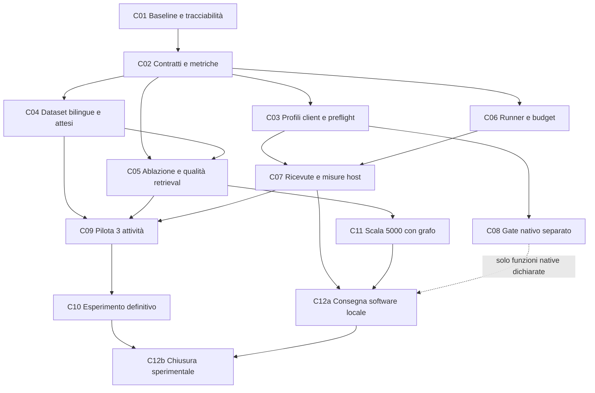

# FastSkillRetrieval — piano ECC di completamento

Data: 22 ottobre 2026, Europe/Rome. Revisione: 1.
Stato: implementazione locale consegnata il 22 ottobre 2026; risultati e gate residui
nel [registro di esecuzione](../doc/Completion_Execution_Report.md).
Metodo: ECC Blueprint, Intent-Driven Development, Eval Harness; revisione indipendente
registrata in [review](FastSkillRetrieval_Completamento_ECC_Review.md).

Questo documento aggiorna l'avanzamento del
[piano P0–P9](FastSkillRetrieval_Capability_Retrieval.md), conservandone gli ID e i criteri
CR01–CR16. Sostituisce la sua sequenza di lavoro residuo, non la storia delle verifiche.
Ricostruisce anche i cinque punti operativi del contesto Claude allegato dall'utente.
Il brainstorming resta una raccolta di estensioni; non rende obbligatorie tutte le sue ipotesi.

## 1. Risultato da consegnare e confini

Consegnare un prodotto locale riproducibile che permetta a Claude Code di cercare e
caricare skill tramite FSR e un esperimento controllato che stabilisca se questo percorso
riduce il materiale di catalogo esposto senza perdere richiami essenziali.

Il completamento ha tre esiti distinti:

1. **Software completo:** preparazione, profili client, runner, ricevute, valutazione,
   packaging e recupero verificati su fixture, anche senza disponibilità del modello.
2. **Validazione del prodotto:** esperimento reale completato con verdetto `passed`,
   `failed` o `inconclusive`; un risultato negativo è valido e non va corretto a posteriori.
   Il beneficio commerciale/operativo è dimostrato solo con `passed` sui criteri congelati.
3. **Funzioni native:** dichiarate separatamente per superficie e versione. Il percorso
   assistito non certifica dispatch automatico, preload o enforcement dei tool dei subagent.
   Se una primitiva manca, la funzione resta chiusa e il relativo gate è non raggiunto.

In scope: Windows/Python 3.13, CLI/MCP locale, Claude Code diretto, 100 skill ECC con
hash fissati, ricerca lessicale e grafo Teseo, valutazione offline e reale, installazione
locale isolata e istruzioni operative. Verifica di scala a 5.000 con il nuovo grafo.

Fuori scope di questa consegna: servizio cloud/multiutente, embedding/provider aggiuntivi,
adapter Codex, dashboard, import dell'intero catalogo personale, scheduler/watchers,
archiviazione automatica e installazioni globali. Queste estensioni erano già separate
dal primo rilascio nel piano storico §7. Non sono necessarie per chiudere CR16.

La manutenzione resta manuale. Nessuna chiave del client viene recuperata o riutilizzata
dal registry. Il core FSR continua a non lanciare modelli: il runner sperimentale è
un processo operatore separato. Nessuna pubblicazione esterna o modifica globale implicita.

## 2. Baseline ricostruita: fatti e limiti delle prove

Progetto originale: `C:/git/FastSkillRetrieval`. Copia della chat:
la cartella locale del repository.
L'implementazione va eseguita nel progetto originale; la copia non è un secondo runtime
da configurare. All'avvio confrontare gli hash, senza sincronizzazioni indiscriminate.

| Origine | Stato ricostruito al 22 ottobre | Evidenza / limite |
|---|---|---|
| P0–P4 | Core implementato e verificato | Contratti, revisioni, migrazione, ingestion, FTS, ledger; test esistenti |
| P5 | Planner e grafo implementati | Chiusura dipendenze, filtri, budget; grafo con 100 nodi e 66 archi |
| P6 | Diagnostica con gate nativo chiuso | `runtime.py` non implementa un canale di attestazione host |
| P7 | Ponte operatore parziale | Ricevute e deleghe storiche; dispatch/preload/enforcement non certificati |
| P8 | Manutenzione esplicita implementata | Reconcile, findings, export, quarantena, rollback |
| P9 locale | Verificato il 21 ottobre | 255 test passati, uno skip; copertura totale 80,64%, grafo 96,11%; build riuscita |
| P9 consegna | Verificato sul corpus fissato | 100/100 manuali identici ai sorgenti, anche via MCP; nessuna prova di applicazione delle istruzioni |
| Isolamento client | Verificato nelle prove del 21 ottobre | Skill native visibili/nascoste e MCP connesso; non equivale a qualità sul lavoro reale |
| Interfaccia client | Configurazione pronta | Registry con 10 tool; istruzioni MCP; nessuna prova generale che Claude scelga sempre FSR |
| P9 utilità / CR16 | Aperto | Vecchio richiamo 20/38 pre-grafo, nessun risultato aggiornato sul nuovo insieme indipendente |
| Scala | Prova storica pre-grafo disponibile | Non riutilizzabile come misura del grafo attuale |

Artefatti del 21 ottobre nella copia della chat, sotto `.work/`:
`probe-isolation/REPORT.md`, `loading-fix/REPORT.md`, `native-block-fix/REPORT.md`,
`graph-implementation/REPORT.md`, `real-graph.json`, `mcp-all-100.json` e log dei test.
Il passo C01 deve acquisirli nel bundle di baseline del progetto originale con hash:
alcuni sono solo nella copia della chat, non nei documenti distribuiti.

Documenti storici: [proposta e decisioni §10](../doc/FastSkillRetrieval_Proposta_Soluzioni.md),
[proposta 100/20](../doc/Capability_Eval_100_20_Proposta.md),
[host](../doc/Capability_Host_Verification.md),
[implementazione](../doc/Capability_Implementazione.md).
I loro vecchi numeri (17 tool, 155/198 test, 88 manuali) restano storia, non stato corrente.

Preflight del 22 ottobre: Git disponibile, branch `main`, tutti i file ancora untracked,
nessun remoto. GitHub CLI disponibile e autenticata; non serve per questo piano.
**Modalità diretta:** nessun commit iniziale di massa, push o PR implicito. Checkpoint con
manifesto SHA-256 e backup dei soli file modificati; uno SHA Git solo quando realmente esiste.

### Problemi individuati nel codice, ancora da correggere

- `scripts/measure_claude_catalog.py:_context_command` usa ancora `--restricted`, fonti
  vuote, `--tools ""` e `--add-dir` sulla cartella skill: non materializza il braccio nativo
  osservato nelle nuove prove. Il vecchio script non è il preflight corretto del confronto.
- `evaluation.py:validate_proposal` accetta conteggi variabili solo con opzione interna;
  il percorso standard continua a richiedere 100/20. Serve una nuova interfaccia esplicita
  per dataset bilingui e ripetizioni, mantenendo la compatibilità del formato storico.
- `evaluate_capabilities.py` valida/approva/misura risultati forniti; non orchestra i due
  client reali. `prepare_real_eval.py` prepara la fixture e non lancia il confronto.
- Il grafo ha 24 riferimenti non risolti: richiedono classificazione, non nodi inventati
  né import automatico di skill esterne. Non impediscono il caricamento delle 100 skill.

## 3. Decisioni conservate e definizioni sperimentali

### Bracci: nomi stabili, senza confondere il vecchio B con il nuovo confronto

| ID | Profilo | Uso |
|---|---|---|
| A_NATIVE | Claude con le 100 skill native, FSR assente | Baseline del confronto reale «senza/con» |
| B_CURATED | Catalogo completo dei descrittori curati, senza retrieval | Braccio obbligatorio per CR16 storico: materializzazione e osservazione host, non sola esposizione offline |
| C_FSR | Catalogo nativo nascosto, FSR con ricerca e grafo | Trattamento del confronto reale |
| L_FTS | Stessi snapshot e descrittori di C, espansione grafo disabilitata | Ablazione offline; eventuali run reali sono un esperimento successivo esplicito |

Conservare l'esperimento storico 100/20, i suoi attesi e il relativo fingerprint.
È un controllo di regressione/development, non un holdout indipendente dopo il tuning.
Nuove traduzioni o parafrasi delle sue domande non diventano automaticamente nuovi casi.
CR16 richiede comunque un rendiconto A/B/C aggiornato sul 100/20 congelato: rimisurarlo
in C10a, etichettandolo come prova descrittiva già usata per sviluppo, senza cambiare gli
attesi. Il nuovo holdout A/C in C10b è aggiuntivo e non sostituisce quel confronto.
Una coppia italiano/inglese dello stesso intento è un gruppo semantico, non due campioni
indipendenti. Separare development, pilota e holdout per gruppo, non per singola frase.

### Criteri di accettazione da congelare in C02

- **Nessuna perdita sui richiami essenziali:** conservare il requisito originario;
  non sostituirlo con una tolleranza del 5% o con la media di buoni risultati.
  Valutare sia copertura degli attesi umani assoluti, sia perdite C rispetto ad A nelle
  coppie osservabili. Se entrambi falliscono, non è un successo per «parità».
  Tutti gli attesi devono stare nei limiti ammessi del prodotto, dichiarati prima dei run.
- **Obiettivo 30%:** la decisione storica §10.1 riguarda materiale di catalogo rispetto
  a B_CURATED; il contesto allegato richiede anche confronto reale A_NATIVE/C_FSR.
  Produrre due campi distinti, con denominatore e metodo: `catalog_B_to_C` e
  `catalog_A_to_C`. Non rinominare il vecchio rapporto B/C come vantaggio nativo A/C.
  Solo misure omogenee osservate consentono il verdetto sulla rispettiva soglia.
- **Costo complessivo:** riportare separatamente token di input/output, cache read/write,
  durata, costo osservato e budget FSR in byte. Un risparmio di catalogo non prova un
  risparmio del runtime; un costo sconosciuto resta `null`, non zero.
- **Latenza locale:** preservare l'obiettivo storico p95 <= 300 ms a regime su 100 e
  5.000 elementi, con metodo dichiarato. Il limite operativo di 2 secondi non lo sostituisce.
- **Qualità del lavoro:** verifiche deterministiche delle fixture e revisione umana per
  output aperti; selezione e lettura di una skill non dimostrano che sia stata applicata.
  Nessun giudice LLM aggiunto implicitamente.

Per il criterio storico B/C l'aggregazione è già confermata in §10.6 della proposta:
`1 - M_C/M_B`, dove M è la media del materiale osservato sui venti casi e `M_B > 0`.
Non sostituirla con la media dei risparmi percentuali individuali; riportare anche ogni
caso. Denominatore zero o dato mancante => `null` con motivo, senza scartare casi e
ricalcolare una media presentata come prova completa. La riduzione per una coppia A/C
con A positivo è `1 - C/A`; fissare prima dei run l'aggregazione del solo nuovo A/C e
la distinzione tra
catalogo iniziale e materiale caricato durante il lavoro e il trattamento delle cache.
Presentare distribuzioni e risultati per lingua; non scegliere dopo la prova la metrica
che supera il 30%. Distinguere `verdict_cases` sui casi osservati da
`generalization_status`: il 100/20 è descrittivo e non richiede una prova statistica di
probabilità nulla di perdita. Eventuali precisione/potenza e popolazione delle nuove
analisi si fissano prima del holdout; non si retroapplicano al criterio storico.
Le stime di byte o del tokenizer sono proxy etichettati, non token
osservati del contesto host. `/context` disabilitato nel braccio C non diventa una misura.

## 4. Criteri osservabili ECC Intent-Driven Development

Tutti richiesti per la superficie dichiarata; G08 è condizionale alla consegna nativa.
I G sono gate del nuovo piano, senza rinumerare i vecchi CR.

| Gate | Scenario e trigger | Esito osservabile e divieto | Verifica |
|---|---|---|---|
| G01 | Avvio da checkout e prove storiche | Manifesto di baseline verificato; nessuna sovrascrittura di sorgenti/stati personali | C01, hash e inventario |
| G02 | Caricamento del protocollo/dataset | Conteggi e attesi validati, split per gruppo e metriche congelate; nessuna modifica retroattiva | C02/C04, test schema e revisione umana |
| G03 | Preflight A/B/C locale | 100 nomi attesi in A, catalogo curato B materializzato e nativo nascosto, catalogo nativo disabilitato e 10 tool connessi in C; zero uso modello nelle sole prove locali | C03, init e contatori d'uso |
| G04 | Ricerca sugli stessi snapshot | L/C confrontabili con configurazione dichiarata, filtri/budget conservati; nessuna conclusione da 100/100 delivery | C05, regressioni e ablazione |
| G05 | Run interrotto o ripetuto | Ogni tentativo ha ID e stato; ripresa senza nascondere fallimenti o superare budget autorizzato | C06, fault injection offline |
| G06 | Parsing eventi del client | Nome/versione, tool e risultati correlati; selected/loaded/applied/unknown distinti; nessun self-report promosso a receipt | C07, fixture eventi e wire smoke |
| G07 | Misura non disponibile | `null` e motivo; niente 30% certificato con byte server, init o mancate consegne | C02/C07/C10, fixture negative |
| G08 | Esecuzione nativa dichiarata | Attestazione runtime e prove della singola funzione, oppure gate chiuso; nessun grant da manuale o receipt solo operatore | C08, prove host distinte |
| G09 | Pilota autorizzato | Tre attività, entrambe le lingue rappresentate, ripetizioni e tutti i costi/esiti salvati; nessun avvio con tetto assente | C09, rapporto pilot |
| G10 | Esperimento definitivo | Tutti i casi congelati e fallimenti visibili; risultato passed/failed/inconclusive motivato per criterio | C10, misure e revisione |
| G11 | Nuovo catalogo 5.000 con grafo | Latenza, consumo e correttezza misurati con corpus/metodo dichiarati; nessun riuso della vecchia latenza pre-grafo | C11, benchmark e fault injection |
| G12 | Installazione da wheel e recupero | Percorso documentato da ambiente nuovo, rollback praticabile e report riproducibile; nessuna modifica globale implicita | C12, smoke da wheel e checklist operatore |

## 5. Incrementi eseguibili e dipendenze

Ogni C è un incremento di dimensione contenuta, assimilabile a una PR; finché non esiste
un remoto si esegue in modalità diretta. Separare ulteriormente uno step se supera i suoi
confini, aggiornando DAG e accettazione prima di scrivere codice.



### C01 — Baseline unica, storico e matrice residua

**Contesto:** P0–P9 esistono; report recenti in parte solo nella copia chat. Git senza
commit/remoto. Non ricostruire il core già verificato.
**Dipendenze:** nessuna. **Superfici:** `plans/`, `doc/`, nuovo bundle `.work/completion-baseline-*`.
**Attività:** acquisire hash di codice, lock, fixture, configurazione MCP e report recenti;
verificare corrispondenza originale/copia; elencare CR01–CR16 e prove correnti; marcare
ricevute mancanti come tali. Aggiornare i rinvii obsoleti, conservando date e numeri storici.
Ricontrollare fixture originale di 100 hash prima di ogni migrazione di prove.
**Verifica:** manifesto SHA-256 e link locali; suite esistente solo quando necessaria
per stabilire la baseline della sessione di implementazione. **Uscita:** G01 e matrice
P/CR/C/G completa, nessuno SHA Git inventato. **Recupero:** bundle nuovo e backup dei soli
documenti aggiornati. **Tier:** standard.

### C02 — Protocollo versionato e criteri prima dei risultati

**Contesto:** `evaluation.py` e schemi v2 supportano l'esperimento storico; mancano run
reali e dataset flessibili nel percorso standard. Decisioni §3 di questo piano prevalgono
su default inventati da un esecutore.
**Dipendenze:** C01. **Superfici:** `evaluation.py`, nuovi `experiment.py`,
`schemas/experiment-v1.schema.json`, `schemas/run-observation-v1.schema.json`, test.
**Attività:** nuovo contratto separato dal v2: protocollo, bracci, corpus/config hash,
gruppi/lingue/split, attesi, repetition ID, versioni, risultati tipizzati, metriche,
errori e budget. Riutilizzare validatori esistenti senza rimuovere il caso 100/20.
Definire stati trial `planned/running/succeeded/failed/timed_out/invalid/unknown` e
distinguere successo tecnico da successo del task. Stabilire scope e accesso al payload
di valutazione: query autorizzate nel dataset, mai nel ledger ordinario del registry.
**Verifica:** futuri `tests/test_experiment_contracts.py`, vecchi `test_evaluation.py`.
**Uscita:** G02/G07; metriche e denominatori congelabili, dati mancanti non promossi a
successo, nessuna chiamata LLM nel core. **Recupero:** nuovo formato/file, nessuna
migrazione distruttiva del v2. **Tier:** approfondito per contratti e misura.

### C03 — Profili A/B/C riproducibili e correzione della misura locale

**Contesto:** probe corretti in `.work/probe-isolation`; script pubblico ancora obsoleto.
Non copiare alla cieca i flag del 21 ottobre su un nuovo client.
**Dipendenze:** C02. **Superfici:** `measure_claude_catalog.py`, nuovo `client_profiles.py`,
template profili, `test_claude_context.py`, futuri test profili.
**Attività:** materializzare 100 copie con hash in cwd isolata; fonti solo project per A,
nessun FSR in A, Skill effettivamente disponibile. Per C nascondere catalogo nativo,
mantenere MCP registry e allowlist esplicita dei tool necessari. Correggere argv senza
concatenazioni shell; separare `/context` (locale, ove disponibile) dal prompt di lavoro.
Controllare init, nomi attesi, collisioni con built-in, connessione, tools e contaminazioni.
Implementare anche B_CURATED: materializzare gli stessi descrittori di C da snapshot
fissati in un catalogo completo e inserirne realmente il contenuto nel contesto mediante
la superficie client verificata, non il solo percorso di un file. Catalogo nativo nascosto,
nessun retrieval e strumenti di caricamento esplicitamente consentiti. Verificare
impronta del contenuto, punto d'ingresso, tool e assenza di catalogo nativo residuo;
conteggiare le differenze inevitabili di superficie. La sola presenza del catalogo sul
disco non vale come esposizione. Se B non è riproducibile, CR16 resta non dimostrato.
Il profilo locale zero-uso usa provider non raggiungibile; non riusarlo per il run reale.
Rilevare versione effettiva, non presumere 2.1.305. `--help` non basta a certificare un flag.
**Verifica:** fixture argv + probe zero-uso protetti, output macchina conservato e redatto.
**Uscita:** G03, vecchio script marcato incompatibile coi vecchi risultati o corretto con
nuovo metodo/fingerprint. Se la versione non consente isolamento, benchmark bloccato con
motivo; sviluppo offline prosegue. **Recupero:** solo nuove directory di fixture.
**Tier:** approfondito per interfaccia host.

### C04 — Dataset nuovo bilingue e revisione umana

**Contesto:** venti richieste italiane già usate per tuning; attesi storici da preservare.
**Dipendenze:** C02. **Superfici:** `examples/experiments/`, nuovi helper di revisione,
validazione in `experiment.py`, rubriche e attesi fuori dalle radici leggibili e scrivibili
del client valutato, non solo fuori dalla sua cwd.
**Attività:** proporre gruppi di intenti originali IT/EN con attività verificabili, skill
essenziali e motivazione basata sul manuale, skill accettabili alternative, casi negativi,
nessuna skill necessaria e ambiguità. Gli attesi operano su ID stabili; massimo cinque
candidati non si risolve aggiungendo attesi oltre budget e dichiarando poi un fallimento
del modello. Separare richiami diretti da dipendenze caricate dal piano.
Proposta iniziale di lavoro: 24 gruppi nuovi con due lingue (48 formulazioni) più tre casi
pilota disgiunti; è una proposta di dataset, non un campione statisticamente adeguato già
dimostrato. Separare development/holdout prima del tuning, fissare il piano di potenza
in C09, ampliare holdout con nuovi gruppi prima di eseguire C10 se necessario.
La fixture attuale contiene solo i 100 `SKILL.md`: censire dipendenze/risorse relative
richieste dai task. Materiale iniziale e risorse devono essere equivalenti in A/B/C;
per ampliare i pacchetti serve un nuovo manifest con hash e versione, senza riscrivere
retroattivamente il corpus storico. Risorse mancanti sono errori visibili del caso, non
un risparmio di contesto o un successo del braccio che non prova a leggerle.
Revisore umano nominato conferma gli essenziali; generazione da agente non equivale a
revisione umana. Nessuna approvazione fittizia inserita nei JSON.
**Verifica:** schema, unicità/gruppi, hash, separazione split e rubriche umane.
**Uscita:** G02 con corpus, pilot e split approvati per il rispettivo uso; holdout non
usato per tuning. **Recupero:** revisione dataset incrementata prima dei run, vecchia
versione conservata. **Tier:** standard per tool; revisore umano per attesi.

### C05 — Qualità retrieval, grafo e controllo senza grafo

**Contesto:** `graph.py` è implementato e partecipa alla ricerca; il solo esempio di
recupero non dimostra un aumento generale di recall. Precedente 20/38 pre-grafo.
**Dipendenze:** C02 e dataset development revisionato di C04; si può iniziare prima
solo il confronto diagnostico sullo storico, senza dichiarare C05 concluso.
**Superfici:** script di ablazione nuovo, configurazione operatore retrieval, `registry.py`,
`graph.py`, `test_skill_graph.py`, test di ranking e cache.
**Attività:** stesso catalogo/snapshot/descrittore/budget per L_FTS e C_FSR; distinguere
espansione da riconoscimento nomi. Rendere la policy esplicita nel fingerprint di ricerca,
senza dare al modello una nuova possibilità di aggirare filtri o budget via MCP. Riportare
richiamo essenziale@5, precisione@5 con denominatore dichiarato, casi completi, omissioni
per budget, zero-match, blocchi e latenza, per lingua e gruppo.
Classificare i 24 riferimenti irrisolti: fuori corpus, componente non skill, ambiguo,
vero difetto del parser. Correggere solo i difetti dimostrati; non importare altri nodi per
migliorare artificialmente il conteggio. Eventuale normalizzazione/ranking IT/EN segue
errori sul development, con regole versionate e regressioni mirate. Niente embedding
impliciti o tuning sugli attesi holdout.
**Verifica:** vecchie 20 domande come regressione; development separato; futuri test di
policy/fingerprint e report ablazione. **Uscita:** G04, rapporto aggiornato con tutti gli
esiti. Se qualità insufficiente, ciclo di correzione sul development e nuovo freeze;
non etichettare il grafo migliore per costruzione. **Recupero:** policy precedente e
catalogo immutabile conservati. **Tier:** approfondito per algoritmo e review.

### C06 — Runner operatore con ripetizioni, budget e ripresa

**Contesto:** nessun orchestratore reale completo; il core non deve incorporare provider.
**Dipendenze:** C02. **Superfici:** nuovo `scripts/run_claude_experiment.py`, modulo
`experiment_runner.py`, test con client finto e clock controllato.
**Attività:** implementare prima dry-run completo; poi lancio CLI esplicito, argv strutturati,
cwd nuova per ogni coppia/caso/ripetizione, client e profilo pin, ordine A/C controbilanciato
e registrato, stessi task/tool di lavoro e medesimo materiale iniziale. Solo la strategia
skill differisce; istruzione C a usare FSR versionata e conteggiata nel contesto.
Preparazione del registry esclusa dai task ma costo/tempo riportati separatamente.
Tetti obbligatori per singolo run, sessione, turni, timeout e budget totale dell'esperimento;
nessun default monetario inventato. Riservare il massimo per ogni trial in corso prima di
lanciarlo; fermare la coda quando il residuo non basta. Limite CLI più supervisore:
terminazione non equivale a garanzia sul costo di richieste già in volo; dichiarare
overshoot massimo configurato e rifiutare avvio se il controllo richiesto non è fattibile.
Ledger durevole con tentativi distinti, resumable, retry espliciti; evitare duplicati
senza eliminare fallimenti/429/timeout. Reset solo delle fixture note, mai dei budget per
far sparire consumi. Parallelismo dei run reali inizialmente uno.
**Verifica:** futuri `test_experiment_runner.py`: timeout, crash tra stato e spawn,
interruzione, retry, riserva concorrenza, output parziale, binario mancante e path con spazi.
**Uscita:** G05 con dry-run senza processi del modello; avvio reale separato e autorizzato.
**Recupero:** stop coda e ripresa da journal; nessuna cancellazione dei risultati falliti.
**Tier:** approfondito per processi/costi e review.

### C07 — Ricevute, applicazione delle skill e osservabilità dei costi

**Contesto:** emissione server, init client e self-report hanno significati diversi.
`/context` non è disponibile nel profilo C completo.
**Dipendenze:** C03/C06. **Superfici:** nuovo parser eventi, schema osservazioni C02,
fixture JSONL redatte, collector correlato e test MCP di integrazione.
**Attività:** correlare run, turni, tool_use/tool_result, riferimento e hash di ogni
manuale. In A osservare invocazioni Skill/letture effettive; in C separare search finali,
prepare, load riusciti, rifiuti e risorse. Un candidato restituito non è una skill scelta;
un caricamento non è applicazione. Le istruzioni possono essere applicate solo con
evidenza del task verificata da grader deterministico o revisione, altrimenti `unknown`.
Registrare tutte le scelte e manuali estranei, non solo quelli attesi.
Per B osservare che il catalogo curato completo sia effettivamente esposto allo stesso
punto di misura di C, includendo istruzioni d'ingresso e cataloghi residui. Non dedurre
questa osservazione dalla sola dimensione di `curated-catalog.json`.
Il client riceve un payload per trial con la sola richiesta e i materiali iniziali:
attesi, rubriche, protocollo completo, altri casi e risultati precedenti restano fuori
dagli input e dalle radici leggibili. Provare il rifiuto di lettura/scrittura con sentinelle
esterne. Se il confine non è verificabile, usare output dichiarativo senza tool filesystem
o classificare il run invalido; una cwd nuova non è una sandbox né protegge il holdout.
Estrarre uso input/output/cache e costo se il client li espone: distinguere stime arrotondate,
fatturazione e contesto occupato. Mai sommare input di tutti i turni chiamandolo dimensione
del catalogo. Ottenere un metodo host osservabile e omogeneo per il catalogo nei bracci;
se non esiste, campo di riduzione host `null`, motivo e conclusione limitata. Byte server
e init non sostituiscono questa prova. Proteggere i checker dalle scritture del modello;
con tool di codice assenti/inaffidabili usare task a output dichiarativo e verifica esterna,
non eseguire codice candidato senza un confine di esecuzione effettivamente verificato.
ECC Eval Harness è il metodo di definizione: le sue utility di candidate execution
rifiutano l'esecuzione senza containment; non usarle come bypass o come prova di isolamento.
**Verifica:** futuri `test_client_observations.py`, casi self-report/errore/parziale,
duplicati, cache, task con marker e wire smoke usando tool reali ma senza modello quando
possibile. **Uscita:** G06/G07 e inventario esplicito delle metriche osservabili.
**Recupero:** conservare raw redatti e parser versionato; rigenerare derivati senza
alterare raw o attesi. **Tier:** approfondito per misura e confini di fiducia.

### C08 — Chiudere la matrice nativa, senza confonderla con la lettura assistita

**Contesto:** P7/CR06/CR14 restano parziali; il ponte HMAC operatore non è da solo
attestazione host di preload, enforcement o esecuzione del piano.
**Dipendenze:** C03; non blocca C09 sul percorso assistito.
**Superfici:** `runtime.py`, `host_bridge.py`, nuova matrice host e test specifici.
**Attività:** identificare primitive osservabili per singola funzione e verificare
correlazione con piano/source/binding revision e lifecycle. Se esiste un canale host
affidabile, implementare adapter minimo per dispatch, ritiro e cancellazione e prove
negative; preload ed enforcement richiedono prove distinte, non zero tool use.
Se la superficie manca, registrare `unsupported/unverified`, mantenere chiuso il gate e
indicare esattamente la capacità di piattaforma necessaria. Nessun JSON del manuale,
callback del modello o firma dell'operatore abilita da solo attivazione nativa.
**Verifica:** offline CR06/CR14, eventuali prove host innocue ripetute tre volte solo con
budget e autorizzazione espliciti; tutte le ricevute preservate.
**Uscita:** matrice attendibile; G08 passa solo per le funzioni realmente provate.
Un risultato unsupported completa la diagnosi, non l'implementazione nativa: P7 rimane
aperto per quella superficie. **Recupero:** rollback adapter e gate nativo chiuso;
nessuna regressione su lettura assistita. **Tier:** approfondito + review indipendente.

### C09 — Pilota su tre attività e dimensionamento della prova

**Contesto:** nessuna prova pagata autorizzata da questo incarico di pianificazione.
**Dipendenze:** C04/C05/C07. **Superfici:** protocollo approvato, runner e nuovi risultati
`.work/experiments/<run-id>`; mai lo stato MCP personale.
**Attività:** tre attività pilot disgiunte da development/holdout, rappresentando IT ed EN.
Proposta operativa: tre ripetizioni per braccio A/C, quindi 18 trial; è un test di pipeline
e costi, non una prova generale di efficacia. Lanciare prima una coppia diagnostica e
proseguire solo se receipts, isolamento e costi sono leggibili. Aggiungere almeno un
trial diagnostico B_CURATED sullo stesso caso di una coppia A/C per verificare il profilo
necessario a CR16: minimo proposto 19 trial, non 18. Contarlo e autorizzarlo nel budget.
Se B non è riproducibile/osservabile, segnare esplicitamente CR16 pending; il nuovo A/C
può comunque proseguire come esperimento separato, senza sostituire il criterio B/C.
Misurare fallimenti, qualità, varianza, cache, durata e costo. Fissare il disegno finale
con unità indipendente = gruppo semantico, coppie A/C e ripetizioni raggruppate; scegliere
numero di gruppi e ripetizioni con potenza/precisione motivata prima del holdout.
Un campione insufficiente rende inconclusiva la generalizzazione; il criterio descrittivo
sui casi osservati conserva un verdetto distinto. Nessuna garanzia dalla sola numerosità
48 o dal pass@3. Esplicitare worst case di spesa, costo di retry e budget richiesto per C10.
**Verifica:** rapporti per tutti i trial, controllo umano di almeno una coppia e replay
offline delle osservazioni. **Uscita:** G09 e protocollo definitivo congelato; se quota o
budget mancano, pilota pending, sviluppo locale concluso non promosso a prova reale.
**Recupero:** stop, conservazione esiti, nuova revisione per eventuale nuovo pilota.
**Tier:** standard per esecuzione, approfondito per analisi del disegno.

### C10 — Confronto definitivo, verdetto e ciclo di miglioramento controllato

**Contesto:** completare CR16 senza usare il dataset finale come tuning set.
**Dipendenze:** C09; protocollo, versioni e budget finale fissati prima di iniziare.
**Superfici:** runner, report machine-readable, relazione umana in `doc/evaluations/`.
**C10a obbligatorio per CR16:** rieseguire e rendicontare A_NATIVE/B_CURATED/C_FSR sulle
20 richieste e sui 100 hash storici, con gli attesi congelati. È una prova descrittiva
esposta al precedente tuning, non holdout. B viene realmente materializzato e osservato
secondo C03/C07; se richiede turni del modello, programmarli e autorizzarne il costo.
La sola misura offline del catalogo B non chiude il criterio host. Per r ripetizioni
pianificate sono `20 * 3 * r` trial, con trattamento delle ripetizioni dichiarato prima
dell'avvio e aggregazione tra venti casi invariata secondo §10.6.
**C10b aggiuntivo:** eseguire il nuovo holdout A/C con gruppi e ripetizioni fissati in C09;
per n formulazioni e k ripetizioni sono `n * 2 * k` trial, distinti da C10a e dal pilota.
**Attività:** eseguire coppie/repetition programmate con stesso snapshot e profili;
riportare ogni trial compresi invalidi e mancanti, motivando esclusioni. Niente aggiornamenti
silenziosi di client, ranking o corpus a metà prova; se cambiano, nuova coorte dichiarata.
Misurare separatamente richiami assoluti, perdite relative A/C, correttezza task,
riduzione catalogo B/C e A/C quando osservabili, token/costi runtime e latenza.
Riportare intervalli con metodo e unità indipendente dichiarati; non trattare traduzioni
e ripetizioni come nuovi intenti. Applicare l'aggregazione storica già confermata per
C10a e quella del nuovo protocollo per C10b, senza trasferire i verdetti tra le due prove.
Se c'è perdita essenziale, la condizione originaria fallisce anche con risparmio >30%.
Se manca una misura host omogenea, il relativo obiettivo resta inconclusive. La precisione
statistica riguarda la distinta pretesa di generalizzazione del nuovo confronto, non una
pretesa di dimostrare probabilità nulla di perdita per chiudere il 100/20 descrittivo.
Niente promozione dal solo punteggio di conformità 100/100.
Un fallimento ritorna a C05 con nuovi casi development; per nuova certificazione serve
un holdout nuovo, non la riscrittura degli attesi del precedente.
**Verifica:** riproduzione offline delle metriche dagli artefatti, review umana di rubriche,
ricevute e verdetto. **Uscita:** G10 con conclusione onesta; beneficio dimostrato solo se
tutti i criteri dichiarati osservabili e richiesti passano. **Recupero:** uso del profilo
nativo A o versione FSR precedente su scelta dell'operatore, senza cancellare risultati.
**Tier:** approfondito per interpretazione/review, standard per esecuzione.

### C11 — Scala 5.000 e costi del grafo

**Contesto:** la latenza storica pre-grafo non copre alias, archi e traversal attuali.
**Dipendenze:** C05. **Superfici:** `test_benchmark_registry.py`,
`test_benchmark_ingestion.py`, nuovi benchmark grafo e script riutilizzabile.
**Attività:** fixture sintetica dichiarata con 100/5.000 nodi, densità diverse, hub,
relazioni irrisolte/cicliche, query IT/EN e casi senza match; snapshot reali, nessuna
semina SQL che salti il percorso ingestion/publication da misurare.
Misurare separatamente ingestion/rebuild, ricerca warm/cold, p50/p95/p99, RSS/memoria
di picco e dimensione DB; dichiarare macchina, versione, numero campioni e warm-up.
Preservare il metodo storico: dieci warm-up e cinque esecuzioni di ognuna delle venti
query, in ordine mescolato registrato, per cento campioni; p95 = 95º valore ordinato,
misurando query strutturata -> risposta serializzata, distinguendo result cache e DB caldo.
Applicarlo su 100 e 5.000; aggiungere il dataset avversario come misura separata.
conservare raw per una nuova stima se insufficienti. Obiettivo p95 <=300 ms a regime,
limiti di traversata rispettati, risposta/budget e filtri intatti sotto hub e concorrenza.
Provare pubblicazione/rebuild interrotti, rollback, cache/fingerprint e schema grafo.
Se fallisce, correggere e ripetere il benchmark pertinente, non cambiare a posteriori
il campione per escludere le query lente. Nessun test di carico su stato personale.
**Verifica:** script locale e regressioni; confronto L/C, nessuna spesa modello.
**Uscita:** G11 o regressione esplicita da risolvere prima della consegna dichiarata.
**Recupero:** stato sintetico isolato, vecchi cataloghi e policy conservati.
**Tier:** standard, approfondito per eventuali cambi di algoritmo/schema.

### C12 — Packaging, profilo d'uso e chiusura documentale

**Contesto:** una wheel locale esiste; manca il pacchetto completo del percorso e della
valutazione finale. `python -m` è il launcher Windows verificato.
**Dipendenze:** C12a da C07/C11 per la consegna software locale; C12b da C10/C12a per
la chiusura sperimentale. C08 solo per funzioni native dichiarate complete.
**Superfici:** README, guide in `doc/`, template MCP/profili, wheel/sdist, changelog locale.
**C12a — Attività locali:** installazione isolata da wheel con dipendenze bloccate, smoke CLI/MCP da
site-packages e preflight client; guida preparazione -> ricerca -> prepare/load ->
diagnostica/aggiornamento/rollback. Profilo guidato che suggerisca FSR senza sostenere che
imponga l'obbedienza del modello. Separare i due livelli di autorialità: operatore prepara
catalogo, sessione lo usa. Nessuna modifica automatica dei file globali del client.
Documentare limiti reali, native gate, riferimenti non risolti, consumi in byte, metriche
host e numero tool. Archiviare bundle verificabile di software, dataset/protocollo,
report locali e checksum; redistribuire solo fixture consentite, senza log sensibili/credenziali.
La consegna software può avvenire con G09/G10 pending: non richiede chiamate pagate.
**C12b — Chiusura sperimentale:** incorporare report C10a/C10b e rispettivi verdetti;
Aggiornare stato P/CR/C/G e dichiarazioni di prodotto al verdetto effettivo.
**Verifica:** build, Ruff, test pertinenti e suite finale, smoke sorgente/wheel,
check manuale del quick start e recovery. Non inventare type-check se non configurato.
**Uscita:** G12 dopo C12a; validazione pending fino a C12b, poi passed/failed/inconclusive,
P7 ancora esplicitamente condizionale se la piattaforma non fornisce prove.
**Recupero:** disabilitare profilo locale e usare configurazione precedente conservata;
nessun rollback che riabiliti quarantene o azzeri consumi. **Tier:** standard + review.

## 6. Ordine operativo, parallelismo e responsabilità

Sequenza raccomandata: C01 -> C02 -> C03 -> C04/C05 -> C06 -> C07 -> C09 -> C10 -> C12b.
C12a può essere consegnato dopo C07/C11 senza attendere modello o budget sperimentale.
C08 procede su una linea separata dopo C03; C11 dopo C05 senza dipendere dai modelli.
Le dipendenze nel DAG prevalgono sulla lista sintetica.

Parallelismo possibile **dopo C02**: contenuti C04 con sviluppo C03/C06, benchmark C11
con pilota C09 dopo completamento C05. Non eseguire parallelamente modifiche a
`evaluation.py`, schema protocollo o facade del registry: responsabile unico di quei file.
I run reali restano seriali fino a prova del budget e dell'isolamento. Questo piano
descrive le opportunità, non avvia automaticamente agenti o attività programmate.

Ruoli: implementatore locale, revisore indipendente di contratti/misure/costi, revisore
umano degli attesi e operatore dei run. L'autore delle domande non si attribuisce
approvazione umana. Un solo operatore custodisce i cap di costo e le autorizzazioni.
Tier approfondito significa ragionamento/review più accurati, non un modello/provider
pagato aggiunto al runtime. Conservare il modello della sessione salvo scelta esplicita.

## 7. Comandi, artefatti e verifica progressiva

Comandi già esistenti, da PowerShell nel progetto originale:

```powershell
$python = (Resolve-Path .venv/Scripts/python.exe).Path
& $python -m ruff check --no-cache src tests scripts
& $python -m pytest -q --basetemp=.work/pytest-completion-<id>
& $python scripts/verify_registry_mcp.py
& $python scripts/evaluate_capabilities.py --help
& $python scripts/measure_claude_catalog.py --help
```

Gli ultimi due help descrivono le interfacce presenti, **non** un benchmark reale corretto.
Per build usare la procedura già verificata e dipendenze offline disponibili; non presumere
accesso alla rete o compilatori extra. Lo skip symlink Windows va riportato, non nascosto.

Interfacce **proposte, da implementare** (non eseguibili oggi):

```text
scripts/run_claude_experiment.py validate --protocol <protocol.json>
scripts/run_claude_experiment.py preflight --protocol <protocol.json> --local-only
scripts/run_claude_experiment.py plan --protocol <protocol.json> --output <new-dir>
scripts/run_claude_experiment.py run --protocol <approved.json> --output <new-dir>
scripts/run_claude_experiment.py resume --run <run-dir>
scripts/run_claude_experiment.py report --run <run-dir> --output <new-file>
scripts/benchmark_skill_graph.py --protocol <benchmark.json> --output <new-dir>
```

`run` richiede budget esplicito, protocollo e revisione appropriati, autenticazione
disponibile e autorizzazione del relativo esperimento. `plan/validate/report` sono offline;
`preflight --local-only` invia solo comandi locali protetti e verifica uso modello zero.
Non aggiungere `--execute` con un default che avvii implicitamente chiamate a pagamento.

Layout di output previsto:

```text
.work/experiments/<run-id>/
  manifest.json                # hash codice/corpus/protocollo/client/profili
  protocol.json               # copia congelata, split e piano analitico
  schedule.json               # coppie e ripetizioni pianificate
  trials/<trial-id>/           # argv redatti, osservazioni, costo, errore, task result
  journal.jsonl               # stato e tentativi; senza segreti
  metrics.json                # derivati rigenerabili, null espliciti
  report.md
```

Gli input/output dei task sono dati di valutazione autorizzati, conservati separatamente
e minimizzati. Non aggirare il vincolo ordinario di retention/eventi del registry copiando
query o file nei suoi log. Prima di condividere un bundle, redazione e verifica umana;
policy di conservazione del benchmark da fissare nel protocollo, senza inventare durate.

Test: per incremento prima i casi del comportamento nuovo, poi regressioni pertinenti;
suite completa ai cambi condivisi e alla chiusura. Nessuna ripetizione a caso dei test
passati; nuovi errori o modifiche devono giustificarla. Copertura non sostituisce ricevute
host o qualità. Non usare le utility ECC di esecuzione candidati dove il gate rifiuta.

## 8. Decisioni residue e condizioni per iniziare

Nessuna decisione blocca la produzione di questo piano o lo sviluppo offline C01–C07/C11.
Prima dei run reali servono: protocollo con attesi revisionati, autenticazione/quota,
cap monetario e margine ammesso per richieste in volo, costo osservabile o metodo di
contabilizzazione concordato, e autorizzazione esplicita della prova. Non assumere che
«scrivi il piano» autorizzi consumo del modello o import del catalogo personale.

Le soglie confermate (nessuna perdita essenziale, obiettivo catalogo 30%, p95 300 ms)
restano tali. Numero finale di gruppi/ripetizioni, unità di misura host e retention del
benchmark sono scelte da congelare con evidenza prima di C10; la quantità proposta C04
non è una garanzia statistica. Se il contesto host non è osservabile, definire il limite
del risultato prima dei run, mantenere `catalog_A_to_C=null` e non promettere il 30%.

## 9. Stato, mutazioni e criteri di chiusura

| Incrementi | Stato iniziale |
|---|---|
| C01–C12 | Pianificati; nessuna implementazione o esecuzione dichiarata da questo documento |
| Software corrente P0–P5/P8/P9 locale | Baseline già implementata; evidenze storiche in §2 |
| P7 / G08 | Parziale e condizionale, da trattare con C08 |
| CR16 / utilità | Da completare con C02–C07/C09–C11 |

Registro di esecuzione: per ogni C aggiungere data, file, comando, artefatto con hash,
esito G/CR, differenze e prossimo passo. Non promuovere un C a verificato dalla sola
presenza del suo file. Una dipendenza può essere soddisfatta solo da un risultato reale.

Mutazioni: mantenere ID P/CR/C/G; nuovi sotto-step C05a/C05b se necessario; ogni variazione
di attesi, metrica o perimetro incrementa protocollo/revisione con motivo. Split/reorder
aggiornano DAG e ownership; i passi saltati restano visibili con motivazione. Un fallimento
non si elimina; un nuovo esperimento non sovrascrive i raw del precedente.

Definition of Done software: gate locali richiesti passati, C12a verificato, software
installabile e recuperabile; eventuale validazione pending dichiarata esplicitamente.
Definition of Done sperimentale: C09/C10a/C10b/C12b eseguiti e riproducibili, verdetto
separato per ogni obiettivo e prova senza numeri inventati. Solo un confronto concluso
consente «validazione completata», e solo un verdetto positivo consente «beneficio
dimostrato» nel perimetro dei casi misurati. La generalizzazione richiede la sua evidenza
separata. Le funzioni native non provate restano dichiarate incomplete.

Revisione 1: ricostruzione dal piano 18 ottobre, contesto Claude e prove 21 ottobre.
La presente attività non avvia Claude Code o benchmark del modello, non modifica codice
applicativo e non crea commit. La revisione del piano è svolta da un agente separato.

### Registro di implementazione — 22 ottobre 2026

Gli stati iniziali sopra descrivono la baseline della revisione 1. L'esecuzione
autorizzata successivamente è registrata in
[Completion_Execution_Report.md](../doc/Completion_Execution_Report.md), con matrice
P/CR/C/G, artefatti e failure preservati. L'utente ha richiesto di svolgere per ora
le attività con la sessione flat corrente anziché Claude Code: le prove assistite
sono aggiuntive, senza rinominare bracci, certificare risparmi host o approvare attesi
automaticamente. Nessun passaggio viene promosso dalla sola presenza di un file.
